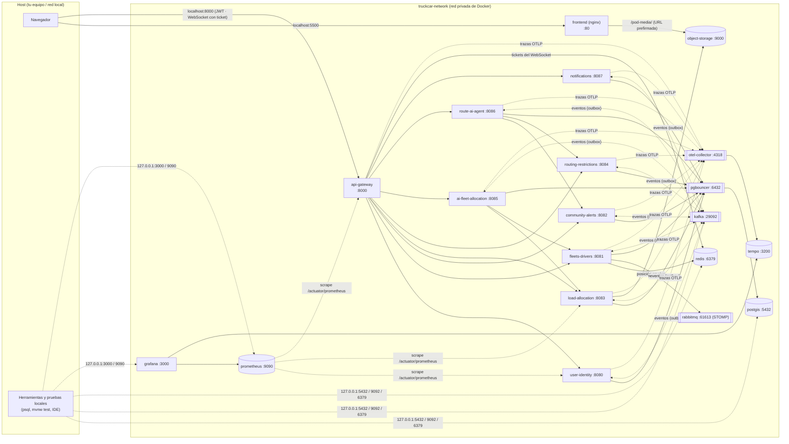

# TruckCar · Deployment-Infrastructure

Orquestación de la plataforma TruckCar: Docker Compose para desarrollo (infraestructura, los 9 microservicios Spring
Boot, el api-gateway, el frontend y el stack de observabilidad), manifiestos de Kubernetes para AWS EKS y Azure AKS
(`k8s/`) y el pipeline de validación de la plataforma. Los microservicios están **aislados en una red privada** con un
único punto de entrada para la API.

## Topología de red



El despliegue en AWS (EKS), el stack por capa, los eventos de Kafka y la telemetría en vivo están en
[docs/arquitectura/ARQUITECTURA.md](docs/arquitectura/ARQUITECTURA.md).

| Componente | Acceso desde el host | Dentro de `truckcar-network` |
|---|---|---|
| **api-gateway** | `http://localhost:8000` (única entrada a la API) | `api-gateway:8000` |
| **frontend** | `http://localhost:5500` | `frontend:80` |
| user-identity, fleets-drivers, community-alerts, load-allocation, routing-restrictions, ai-fleet-allocation, route-ai-agent, notifications | **ninguno** (sin `ports:`) | `<servicio>:<puerto>`, p. ej. `load-allocation:8083` |
| PostgreSQL / Kafka / Redis | solo `127.0.0.1:5432`, `127.0.0.1:9092`, `127.0.0.1:6379` | `postgis:5432`, `kafka:29092`, `redis:6379` |
| Grafana / Prometheus | solo `http://127.0.0.1:3000`, `http://127.0.0.1:9090` | `grafana:3000`, `prometheus:9090` |
| otel-collector, Tempo, pgbouncer-exporter, actuator del gateway | **ninguno** | `otel-collector:4318`, `tempo:3200`, `pgbouncer-exporter:9127`, `api-gateway:8090` |

- El gateway valida el JWT, descarta las cabeceras de identidad que envíe el cliente y propaga
  `X-Auth-User`, `X-Auth-Role` y `X-Correlation-Id` a los servicios.
- Como los microservicios no publican puertos, nadie puede saltarse el gateway ni falsificar esas
  cabeceras llamando directamente a `:8081`, `:8083`, etc.
- Los servicios se llaman entre sí por nombre de contenedor (`http://load-allocation:8083`); las URLs se
  pueden sobrescribir con variables (ver [Desarrollo local](#desarrollo-local-un-servicio-desde-el-ide)).

## Base de datos: un esquema por servicio y PgBouncer

- `truckcar_db` tiene **un esquema y un rol por servicio** (`user_identity`, `load_allocation`, `fleets_drivers`,
  `community_alerts`, `routing_restrictions`, `fleet_allocation`, `route_ai_agent`, `notifications`). Cada rol es dueño
  solo de su esquema: un servicio no puede leer las tablas de otro. En `public` solo queda PostGIS.
- El job `db-init` (`docker/postgres/init-service-schemas.sql`) crea roles y esquemas y, en bases anteriores, **mueve
  las tablas de `public` a su esquema conservando los datos**. Es idempotente y corre en cada `docker compose up`.
- Cada servicio versiona su esquema con **Flyway** (`src/main/resources/db/migration`, historial en su propio esquema)
  y arranca con `ddl-auto: validate`.
- Los servicios se conectan a **PgBouncer** (`pgbouncer:6432`, modo `transaction`, JDBC con `prepareThreshold=0`):
  decenas de instancias comparten como máximo 60 conexiones reales. PgBouncer obtiene las contraseñas de PostgreSQL
  (`auth_query`); el `search_path` de cada servicio lo fija su rol.
- Las contraseñas de los roles (`TRUCKCAR_DB_PASSWORD_<SERVICIO>`) se asignan al **crear** el rol. Para rotarlas:
  `ALTER ROLE <rol> PASSWORD '...'`, actualizar `.env` y reiniciar el servicio.

## Observabilidad: trazas, métricas y dashboards

- **Trazas distribuidas** (Micrometer Tracing + OpenTelemetry): cada servicio exporta por OTLP al `otel-collector`, que
  las guarda en **Tempo**. El contexto W3C (`traceparent`) y el `X-Correlation-Id` que genera el gateway viajan por
  HTTP (RestClient), Kafka (cabeceras de cada registro, también a través del outbox: cada evento guarda la traza que lo
  originó) y los frames STOMP de telemetría. Una carga publicada produce **una sola traza** que recorre gateway →
  Load-Allocation → Kafka → AI-fleet → Load-Allocation → Notifications.
- **Logs** con `[servicio,traceId,spanId] [cid=X-Correlation-Id]` en cada línea: del log se llega a la traza.
- **Métricas Prometheus** en `/actuator/prometheus` de cada servicio (el gateway en `:8090`), descubiertas por DNS
  (cada réplica de fleets-drivers es un target). El gateway no enruta `/actuator/**`: nada de esto se expone fuera.
  Además de JVM, HTTP, Hikari, Kafka y Resilience4j hay métricas de negocio:
  `truckcar_load_assignment_latency_seconds`, `truckcar_load_assignment_outcomes_total`,
  `truckcar_allocation_matching_seconds`, `truckcar_ai_requests_total` y `truckcar_ai_fallback_total`.
- **Grafana** (`http://127.0.0.1:3000`, usuario `admin`, contraseña `TRUCKCAR_GRAFANA_ADMIN_PASSWORD` de `.env`) trae
  aprovisionados Prometheus, Tempo y tres dashboards (`docker/observability/grafana/dashboards/`):
  - **TruckCar · Plataforma**: latencia de asignación, duración del matching, tasa de fallback de IA, circuit breakers,
    throughput, errores y lag de Kafka, API y lotes `/sync/batch` (con las trazas recientes de Tempo).
  - **TruckCar · JVM**: heap, GC, CPU, hilos y pools Hikari por servicio.
  - **TruckCar · PgBouncer**: conexiones de cliente y de servidor por rol, clientes en espera, consultas y latencia.
- Para buscar la traza de una petición: Grafana → Explore → Tempo → `{ span."X-Correlation-Id" = "<valor>" }` (el
  valor vuelve en la cabecera `X-Correlation-Id` de cada respuesta del gateway).
- Alertas base en `docker/observability/prometheus/rules/` (servicio caído, 5xx, fallback de IA, PgBouncer saturado,
  lag de Kafka). Muestreo de trazas: `TRUCKCAR_TRACING_SAMPLING_PROBABILITY` (1.0 en local).

## Evidencias de entrega (POD) y PWA offline

- La firma y la foto de la entrega se guardan en un **almacenamiento compatible con S3** (`object-storage`, RustFS;
  en producción Amazon S3). La PWA pide a Load-Allocation URLs **prefirmadas** que fijan tipo, tamaño y SHA-256, sube
  el archivo directamente y la entrega solo envía su clave y hash. La base de datos no guarda imágenes.
- El almacenamiento no publica puertos: el nginx del frontend lo sirve en `/pod-media/` (mismo origen, sin CORS).
- La PWA del conductor funciona sin señal: un **Service Worker** (`sw.js`) guarda la aplicación y las teselas del
  mapa, y una **cola durable en IndexedDB** (`js/offlineQueue.js`) guarda posiciones, inicio y entrega del viaje
  (con sus imágenes) y alertas. Al reconectar se envían en lotes a `/api/v1/{fleets-drivers|loads|alerts}/sync/batch`;
  el backend los aplica en orden y sin duplicar (tabla `ingested_events`).

## SOS y seguimiento público de envíos

- **SOS**: `POST /api/v1/alerts/sos` (solo CONDUCTOR; el conductor sale del JWT). Community-Alerts guarda el SOS y su
  evento en el outbox en la misma transacción y lo publica justo después del commit en `truckcar.events.sos`
  (`alert.sos.triggered` / `alert.sos.acknowledged`), un tópico propio que Notifications consume en su contenedor de
  alta prioridad (push `EMERGENCIA_SOS`). La torre lo ve en `GET /api/v1/alerts/sos` y lo atiende con
  `PATCH /api/v1/alerts/sos/{id}/acknowledge`. Sin señal, la PWA lo encola (`alert.sos`) y sale primero al reconectar.
  Un SOS **nunca se rechaza** por sus datos: sin GPS válido se usa la última posición del conductor en fleets-drivers
  (`locationSource: LAST_KNOWN`, con `locationRecordedAt`) y, si no hay ninguna, queda `UNKNOWN` sin coordenadas. El
  conductor anula una falsa alarma con `PATCH /api/v1/alerts/sos/{id}/cancel` (`alert.sos.cancelled`); la torre filtra
  con `GET /api/v1/alerts/sos?status=ACTIVE,ACKNOWLEDGED,RESOLVED,CANCELLED` (sin `status`, las abiertas).
- **Seguimiento público**: `POST /api/v1/loads/{loadId}/public-tracking-link` (GENERADOR dueño, COORDINADOR o ADMIN)
  firma un token HMAC-SHA256 con `TRUCKCAR_TRACKING_LINK_SECRET`. Vence a las 48 h o 6 h después de la entrega, lo
  que llegue primero. `GET /api/v1/loads/public-tracking/{token}` es la única ruta anónima de cargas en el gateway (solo
  GET, sin `..` ni separadores codificados) y devuelve el estado y la posición en vivo (desde fleets-drivers) sin datos
  personales. La PWA abre la vista con `?track=<token>` en `TRUCKCAR_PUBLIC_APP_URL`.

## Estructura

```
Deployment-Infrastructure/          <- este repo
├── docker-compose.yml              stack completo y red truckcar-network
├── docker-compose.debug.yml        override opcional: puertos internos en 127.0.0.1
├── docker/
│   ├── spring-service.Dockerfile   imagen común (Maven -> JRE 21, usuario sin privilegios)
│   ├── postgres/  pgbouncer/  nginx/
│   └── observability/              otel-collector, Tempo, Prometheus (+ alertas) y Grafana (datasources y dashboards)
├── k8s/                            Kubernetes: base + overlays aws-eks y azure-aks (ver k8s/README.md)
├── .github/workflows/platform.yml  validación estática y prueba del stack completo (reutilizable por los servicios)
├── scripts/                        clone-repos, init-env y verify-isolation (.sh y .ps1); teardown.sh (EKS)
├── .env.example                    todas las variables, con su clave en AWS Secrets Manager / Azure Key Vault
├── User-Identity/  api-gateway/  fleets-drivers/  ...   <- repos de servicios (no versionados aquí)
└── truckcar-frontend/
```

Los repositorios de los servicios se clonan **dentro** de esta carpeta (el `.gitignore` los excluye):
`docker-compose.yml` construye cada imagen desde `./<repo>`.

## Puesta en marcha

Requisitos: Docker Desktop (o Docker Engine + Compose v2), Git y acceso a la organización TRUCKCAR-APP (TruckCar) en GitHub.
Unos 8 GB de RAM libres (cada servicio tiene un límite de 768 MB).

**Windows (PowerShell)**

```powershell
git clone https://github.com/TRUCKCAR-APP/Deployment-Infrastructure.git truckcar
cd truckcar
powershell -ExecutionPolicy Bypass -File scripts\clone-repos.ps1
powershell -ExecutionPolicy Bypass -File scripts\init-env.ps1
docker compose up -d --build
```

**Linux / macOS / Git Bash**

```bash
git clone https://github.com/TRUCKCAR-APP/Deployment-Infrastructure.git truckcar && cd truckcar
bash scripts/clone-repos.sh
bash scripts/init-env.sh
docker compose up -d --build
```

La primera construcción compila los 9 servicios (varios minutos); las siguientes reutilizan la caché de Maven.
`docker compose ps` debe mostrar todos los contenedores `Up` (postgis, kafka, redis y frontend `healthy`).

Abrir `http://localhost:5500`, registrarse e iniciar sesión. Para actualizar el código:
`scripts/clone-repos.*` (hace `git pull` de cada repo) y `docker compose up -d --build`.

## Verificación del aislamiento

Tras cada despliegue (y después de volver del modo debug) ejecute:

```bash
./scripts/verify-isolation.sh                                          # Linux / macOS / Git Bash
powershell -ExecutionPolicy Bypass -File scripts\verify-isolation.ps1   # Windows PowerShell
```

Comprueba que los puertos internos (`:8080`–`:8087`, el actuator del gateway, PgBouncer, el collector y Tempo) **no**
respondan desde el host; que el gateway (`:8000`) exija JWT y no deje alcanzar `/actuator/**` (tampoco con rutas
`../`); que Prometheus sí llegue a `/actuator/prometheus` dentro de `truckcar-network`, y que Grafana y Prometheus solo
escuchen en `127.0.0.1`. Termina con código distinto de 0 si algo falla: es el paso de aislamiento del CI.

## CI/CD

| Repo | Workflow | Qué hace |
|---|---|---|
| Cada servicio backend | `.github/workflows/ci.yml` | `mvn clean verify` con PostgreSQL/PostGIS, Kafka (y Redis en fleets-drivers) efímeros; en `main`, imagen en `ghcr.io/truckcar-app/<servicio>`; y el job **Plataforma** (abajo) con el servicio en su commit. |
| truckcar-frontend | `.github/workflows/ci.yml` | Sintaxis de todos los scripts, ESLint y pruebas de `sw.js` y `js/offlineQueue.js` (IndexedDB en memoria); en `main`, imagen nginx de la PWA. |
| Deployment-Infrastructure | `.github/workflows/platform.yml` | Validación estática (`docker compose config` y que no resuelva sin `.env`, `promtool`, `otelcol validate`, dashboards, `kustomize` + `kubeconform` de los cuatro overlays) y el **stack completo**: `docker compose up --build` con secretos generados, `verify-isolation.sh`, targets de Prometheus y trazas en Tempo. |

Los repos de TRUCKCAR-APP son públicos: el job del stack completo los clona sin credenciales y exige que pasen las 25
comprobaciones de `verify-isolation.sh`.

### Imágenes en Amazon ECR (AWS Academy Learner Lab)

| Workflow | Cuándo | Qué hace |
|---|---|---|
| `.github/workflows/ecr-image.yml` (reutilizable) | Lo llama el job **ecr** del `ci.yml` de cada repo, en cada push a `main` | Construye una imagen (Dockerfile común de Spring o el propio de la PWA) y la publica como `<cuenta>.dkr.ecr.<región>.amazonaws.com/truckcar/<imagen>` con las etiquetas `:<commit>` y `:main`. La primera vez crea el repositorio de ECR (escaneo al publicar). |
| `.github/workflows/ecr-all.yml` (manual) | Al iniciar un laboratorio nuevo, o si hubo pushes con las credenciales vencidas | Publica las 10 imágenes desde `main` de cada repo (o la referencia indicada) |

**Credenciales:** el Learner Lab no permite crear el rol OIDC para GitHub Actions, así que se usan las credenciales
temporales de la sesión.
- **Dónde:** como **secretos de la organización** TRUCKCAR-APP (*Settings → Secrets and variables → Actions*), visibles para
  los 11 repos: `AWS_ACCESS_KEY_ID`, `AWS_SECRET_ACCESS_KEY` y `AWS_SESSION_TOKEN`, copiados de *AWS Details → AWS CLI*
  del laboratorio.
- **Región:** la variable de organización `AWS_REGION` (opcional, `us-east-1` por defecto).
- **Vencen con cada sesión** (unas 4 horas): al empezar a trabajar se actualizan los tres secretos.
  - Con las credenciales vencidas, el job **ecr** falla con un mensaje que lo explica: se actualizan y se vuelve a ejecutar.
  - Sin secretos configurados, el job termina con un aviso y no publica.
- **Desde la terminal**, con un token con el permiso `admin:org`:

```bash
gh secret set AWS_ACCESS_KEY_ID     --org TRUCKCAR-APP --visibility all --body "$AWS_ACCESS_KEY_ID"
gh secret set AWS_SECRET_ACCESS_KEY --org TRUCKCAR-APP --visibility all --body "$AWS_SECRET_ACCESS_KEY"
gh secret set AWS_SESSION_TOKEN     --org TRUCKCAR-APP --visibility all --body "$AWS_SESSION_TOKEN"
gh workflow run "ECR all images" --repo TRUCKCAR-APP/Deployment-Infrastructure   # publicar las 10 de una vez
```

## Secretos

Ningún archivo versionado contiene credenciales: `docker-compose.yml` exige cada secreto (`${VAR:?...}`) y no arranca
sin `.env`, y los `application.yml` de los servicios no traen contraseñas por defecto (fuera de Docker se definen
`DB_USER` y `DB_PASSWORD`).

- **Local:** `scripts/init-env.*` genera `.env` con un valor aleatorio para cada variable marcada `[secreto]` en
  `.env.example` (contraseñas de PostgreSQL por servicio, S3, RabbitMQ, PgBouncer, Grafana y el JWT). Con un `.env`
  existente solo agrega las variables que falten.
- **Producción:** los mismos valores viven en **AWS Secrets Manager** (`truckcar/jwt-secret`, `truckcar/db/<servicio>`...)
  o **Azure Key Vault** (`truckcar-jwt-secret`, `truckcar-db-<servicio>`...). External Secrets Operator los sincroniza en
  el Secret `truckcar-secrets` del namespace (`k8s/overlays/*/external-secrets.yaml`). En EKS, Load-Allocation accede a
  S3 con IRSA (sin claves).
- **Rotación de contraseñas de base de datos:** `ALTER ROLE <rol> PASSWORD '...'` en PostgreSQL, actualizar el valor en
  `.env` (o en el gestor de secretos) y reiniciar el servicio. db-init solo asigna contraseñas al crear un rol.

## Kubernetes

`k8s/` contiene la base común y los overlays `aws-eks` y `azure-aks` (kustomize): Deployments con probes, límites,
`securityContext` restringido y HPA/PDB; Service **headless** de fleets-drivers para el balanceo DNS del WebSocket;
ConfigMap de plataforma; Secret vía External Secrets; Ingress; NetworkPolicies equivalentes a `truckcar-network`;
PgBouncer, el Job db-init y el otel-collector. Detalle y despliegue en [k8s/README.md](k8s/README.md).

### Desmontaje en Amazon EKS (AWS Academy Learner Lab)

Al terminar, desmonte con `scripts/teardown.sh` en lugar de borrar el clúster desde la consola. Si el clúster se borra
primero, el ALB del Ingress y los discos EBS quedan huérfanos, y la VPC no se puede eliminar.

```bash
# 1. Credenciales vigentes del Learner Lab (Start Lab > AWS Details) y kubectl apuntando al clúster
aws eks update-kubeconfig --name truckcar-cluster --region us-east-1

# 2. Ver qué se haría, sin borrar nada
./scripts/teardown.sh --dry-run

# 3. Desmontar: pide escribir el nombre del clúster para confirmar (--yes la omite)
./scripts/teardown.sh
```

El orden es estricto y cada paso se comprueba contra la API de AWS antes de seguir:

1. **Ingress.** El AWS Load Balancer Controller borra el ALB y sus Security Groups. El script espera a que AWS ya no
   tenga balanceadores con la etiqueta del clúster; si no desaparecen, se detiene sin tocar nada más.
2. **StatefulSets y PVCs.** Primero los StatefulSets de Kafka, Redis y RabbitMQ, porque un PVC en uso no se borra.
   Después los PVCs, cuyos discos EBS gp3 se eliminan (`reclaimPolicy: Delete`). El script espera a que no quede
   ningún disco del namespace.
3. **RDS dentro de la VPC del clúster.** Borra cada instancia sin snapshot final y espera a que desaparezca. Después
   borra su grupo de subredes y sus Security Groups. Conserva el `default` de la VPC y los que creó eksctl, y reintenta
   mientras AWS libera la interfaz de red de la base. Mientras existan, CloudFormation no puede borrar la VPC.
4. **Pausa de 30 s** para las eliminaciones en segundo plano.
5. **`eksctl delete cluster`:** nodegroups, clúster y el stack de la VPC.
6. **Informe** de lo que no se borra: repositorios ECR `truckcar/*`, instancias RDS fuera de la VPC y buckets S3 con
   `truckcar` en el nombre, y la distribución de CloudFront si se creó. Se imprimen los comandos para borrarlos a mano.

Salvaguardas:
- Se detiene si las credenciales vencieron, si el clúster no existe o si `kubectl` apunta a otro contexto.
- Busca las instancias RDS de la VPC antes de borrar nada. Si alguna tiene protección contra borrado, se detiene sin
  tocar nada e indica el comando para desactivarla. La confirmación nombra las instancias que se van a borrar.
- Se configura con variables:

  | Variable | Por defecto |
  |---|---|
  | `TRUCKCAR_CLUSTER_NAME` | `truckcar-cluster` |
  | `AWS_REGION` | `us-east-1` |
  | `TRUCKCAR_NAMESPACE` | `truckcar` |
  | `TRUCKCAR_TEARDOWN_TIMEOUT` (segundos de espera por el ALB, los discos y los Security Groups; RDS usa el waiter de la CLI, hasta 30 min) | `300` |

**Se pierden los datos de Kafka, Redis, RabbitMQ y de la base RDS de la VPC del clúster, que se borra sin snapshot
final.** Los buckets S3 y los repositorios ECR no se tocan.

## Variables (`.env`)

`scripts/init-env.*` crea `.env` desde `.env.example` con secretos aleatorios. **`.env` no se versiona.** La lista
completa está en `.env.example`; las principales:

| Variable | Obligatoria | Uso |
|---|---|---|
| `TRUCKCAR_JWT_SECRET` | sí | Secreto JWT en Base64 (≥ 256 bits) compartido por user-identity, api-gateway y notifications. Sin ella `docker compose` no arranca. |
| `TRUCKCAR_DB_ADMIN_PASSWORD`, `TRUCKCAR_DB_PASSWORD_<SERVICIO>` | sí | Administrador de PostgreSQL (db-init y PgBouncer) y rol de cada servicio. |
| `TRUCKCAR_S3_SECRET_KEY`, `TRUCKCAR_STOMP_RELAY_PASSCODE`, `TRUCKCAR_PGBOUNCER_STATS_PASSWORD`, `TRUCKCAR_GRAFANA_ADMIN_PASSWORD` | sí | Almacenamiento de evidencias, RabbitMQ, métricas de PgBouncer y Grafana. |
| `TRUCKCAR_TRACKING_LINK_SECRET` | sí | Clave HMAC de los enlaces públicos de seguimiento (Load-Allocation). Rotarla invalida los enlaces emitidos. |
| `TRUCKCAR_PUBLIC_APP_URL` | no | PWA que abre los enlaces de seguimiento (`http://localhost:5500/` por defecto). |
| `TRUCKCAR_TRACING_SAMPLING_PROBABILITY` | no | Fracción de peticiones trazadas (1.0 por defecto). |
| `TRUCKCAR_ADMIN_EMAIL`, `TRUCKCAR_ADMIN_PASSWORD` | no | ADMIN inicial: user-identity lo crea al arrancar si no existe ningún ADMIN (contraseña de 12 a 72 caracteres). Sin ellas no se crea ninguno. |
| `AZURE_OPENAI_ENDPOINT`, `AZURE_OPENAI_KEY`, `AZURE_OPENAI_DEPLOYMENT` | no | Route-AI-agent, con el despliegue `gpt-4.1-mini` por defecto. Sin ellas (o si Azure falla, tarda más de 4 s o responde 429) las alertas se interpretan por reglas de palabras clave y ninguna se pierde. |
| `HERE_API_KEY` | sí, para planear rutas | Route-AI-agent: rutas para camión con HERE Routing v8 (altura, peso bruto, peso por eje, ejes y peajes en COP) y HERE Geocoding para las ciudades sin coordenadas. Sin ella, `POST /api/v1/routes/plan` responde 503; nunca se inventa una ruta. |
| `TRUCKCAR_ASSIGNMENT_RESPONSE_TIMEOUT_MINUTES` | no | Minutos que tiene un conductor para responder una propuesta (por defecto 60). |
| `TRUCKCAR_NOTIFICATIONS_API_KEY` | no | Habilita `POST /api/v1/notifications/send` con `X-API-KEY`. |
| `TRUCKCAR_FRONTEND_DIR` | no | Carpeta del frontend si no es `./truckcar-frontend`. |
| `TRUCKCAR_<SERVICIO>_URL` | no | Redirige las llamadas a un servicio (ver desarrollo local). |

Cambiar `TRUCKCAR_JWT_SECRET` invalida las sesiones abiertas: hay que volver a iniciar sesión.

El access token dura 15 minutos y el frontend lo renueva solo con el refresh token (7 días, de un solo uso).

## Desarrollo local: un servicio desde el IDE

Para depurar un servicio (ejemplo: **load-allocation**) se apaga su contenedor, se ejecuta desde el IDE y se
redirige hacia el host a quienes lo llaman (el gateway y, en este caso, AI-fleet):

```bash
# 1. Apagar el contenedor del servicio
docker compose stop load-allocation

# 2. Ejecutarlo en el host: por defecto usa localhost:5432 / 9092 / 6379, que están publicados en 127.0.0.1.
#    La contraseña de PostgreSQL no tiene valor por defecto: DB_PASSWORD = TRUCKCAR_DB_ADMIN_PASSWORD de .env
cd Load-Allocation
DB_PASSWORD='<TRUCKCAR_DB_ADMIN_PASSWORD>' ./mvnw spring-boot:run   # PowerShell: $env:DB_PASSWORD='...'; .\mvnw.cmd spring-boot:run

# 3. En otra terminal, desde la raíz: redirigir a quienes lo llaman (--no-deps evita que
#    Compose vuelva a arrancar el contenedor de load-allocation, del que depende el gateway)
TRUCKCAR_LOAD_ALLOCATION_URL=http://host.docker.internal:8083 \
  docker compose up -d --no-deps api-gateway ai-fleet-allocation
```

En PowerShell el paso 3 es:

```powershell
$env:TRUCKCAR_LOAD_ALLOCATION_URL = 'http://host.docker.internal:8083'
docker compose up -d --no-deps api-gateway ai-fleet-allocation
Remove-Item Env:TRUCKCAR_LOAD_ALLOCATION_URL
```

La API sigue entrando por `http://localhost:8000` y el frontend no cambia.

**Volver a la configuración normal:** detener el proceso del IDE y ejecutar `docker compose up -d`
(sin la variable): recrea el gateway y AI-fleet con las URLs internas y vuelve a arrancar el contenedor.
Después, ejecutar `scripts/verify-isolation.*`.

| Servicio en el IDE | Variable a redirigir | Contenedores a recrear con `--no-deps` |
|---|---|---|
| user-identity | `TRUCKCAR_USER_IDENTITY_URL` | `api-gateway` |
| fleets-drivers | `TRUCKCAR_FLEETS_DRIVERS_URL` | `api-gateway ai-fleet-allocation` |
| community-alerts | `TRUCKCAR_COMMUNITY_ALERTS_URL` | `api-gateway route-ai-agent` |
| load-allocation | `TRUCKCAR_LOAD_ALLOCATION_URL` | `api-gateway ai-fleet-allocation` |
| routing-restrictions | `TRUCKCAR_ROUTING_RESTRICTIONS_URL` | `api-gateway route-ai-agent` |
| ai-fleet-allocation | `TRUCKCAR_AI_FLEET_ALLOCATION_URL` | `api-gateway` |
| route-ai-agent | `TRUCKCAR_ROUTE_AI_AGENT_URL` | `api-gateway` |
| notifications | `TRUCKCAR_NOTIFICATIONS_URL` | `api-gateway` |

Notas:

- Las pruebas de contexto de cada servicio (`./mvnw verify`) usan la misma base local: definir `DB_PASSWORD` antes.
- **No dejes corriendo el contenedor y el IDE a la vez**: ambos consumirían los mismos tópicos de Kafka
  con el mismo grupo y se repartirían los eventos.
- user-identity, api-gateway y notifications necesitan `TRUCKCAR_JWT_SECRET` en el entorno del IDE con
  **el mismo valor** que `.env`.
- Si el servicio del IDE llama a otros que siguen en Docker (ai-fleet → load-allocation y fleets-drivers;
  route-ai-agent → community-alerts y routing-restrictions), sus puertos internos no están publicados.
  Levanta el stack con el override de depuración, que los publica **solo en 127.0.0.1**:

  ```bash
  docker compose -f docker-compose.yml -f docker-compose.debug.yml up -d
  ```

  Al terminar, `docker compose up -d` (sin el override) los vuelve a cerrar.

## Comandos útiles

```bash
docker compose logs -f api-gateway load-allocation   # logs de uno o varios servicios
docker compose up -d --build load-allocation         # reconstruir un servicio tras cambiar su código
docker compose restart notifications
docker compose down                                  # detener todo (conserva datos)
docker compose down -v                               # detener y borrar PostgreSQL y Redis
```

## Solución de problemas

| Síntoma | Causa y solución |
|---|---|
| `required variable TRUCKCAR_... is missing a value` | Falta `.env` o una variable nueva: ejecutar `scripts/init-env.*` (agrega las que falten). |
| `password authentication failed` tras actualizar | El volumen de PostgreSQL ya tenía roles con otras contraseñas: poner en `.env` las que usa ese volumen (o rotarlas con `ALTER ROLE`). |
| Un panel de Grafana sin datos | Las métricas de negocio aparecen con el primer evento (carga publicada, fallback de IA). Ver los targets en `http://127.0.0.1:9090/targets`. |
| `port is already allocated` en 5432/9092/6379/8000/5500 | Otro proceso o un compose antiguo usa el puerto: detenerlo (`docker compose down` en ese proyecto). |
| Todas las peticiones responden 401 | Sesión firmada con otro secreto (se cambió `.env`): volver a iniciar sesión. |
| Un servicio se reinicia en bucle | `docker compose logs <servicio>`; suele ser la base o Kafka aún sin arrancar (se recupera solo). |
| La carga no avanza a `NOTIFIED` | Revisar `docker compose logs notifications ai-fleet-allocation`. |
| `curl localhost:8083` no responde | Es lo esperado: los servicios solo se alcanzan por el gateway (`localhost:8000`). |
