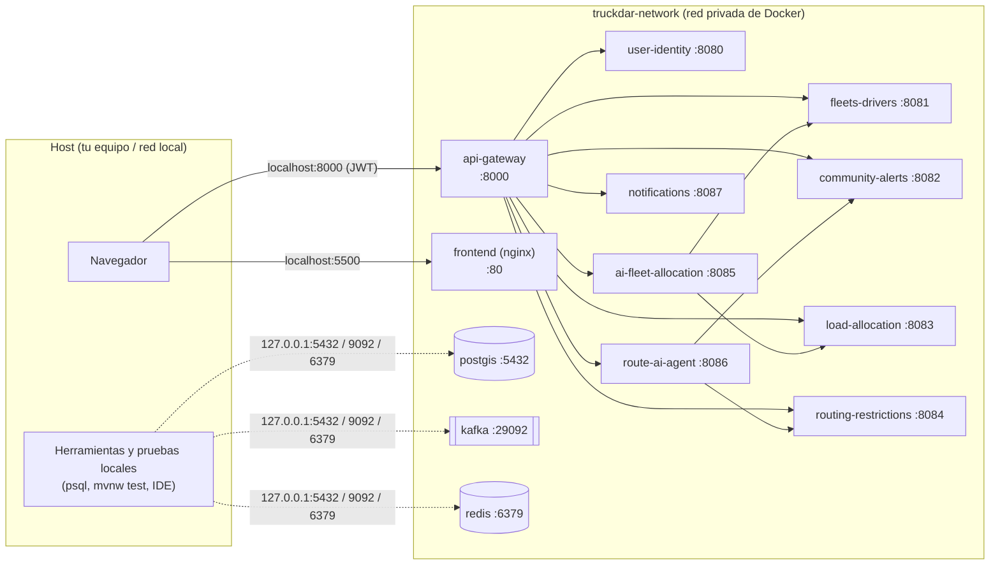

# TruckDar · Deployment-Infrastructure

Orquestación local de la plataforma TruckDar con Docker Compose: infraestructura (PostgreSQL + PostGIS,
Kafka y Redis), los 9 microservicios Spring Boot, el api-gateway y el frontend, con los microservicios
**aislados en una red privada** y un único punto de entrada para la API.

## Topología de red



| Componente | Acceso desde el host | Dentro de `truckdar-network` |
|---|---|---|
| **api-gateway** | `http://localhost:8000` (única entrada a la API) | `api-gateway:8000` |
| **frontend** | `http://localhost:5500` | `frontend:80` |
| user-identity, fleets-drivers, community-alerts, load-allocation, routing-restrictions, ai-fleet-allocation, route-ai-agent, notifications | **ninguno** (sin `ports:`) | `<servicio>:<puerto>`, p. ej. `load-allocation:8083` |
| PostgreSQL / Kafka / Redis | solo `127.0.0.1:5432`, `127.0.0.1:9092`, `127.0.0.1:6379` | `postgis:5432`, `kafka:29092`, `redis:6379` |

- El gateway valida el JWT, descarta las cabeceras de identidad que envíe el cliente y propaga
  `X-Auth-User`, `X-Auth-Role` y `X-Correlation-Id` a los servicios.
- Como los microservicios no publican puertos, nadie puede saltarse el gateway ni falsificar esas
  cabeceras llamando directamente a `:8081`, `:8083`, etc.
- Los servicios se llaman entre sí por nombre de contenedor (`http://load-allocation:8083`); las URLs se
  pueden sobrescribir con variables (ver [Desarrollo local](#desarrollo-local-un-servicio-desde-el-ide)).

## Estructura

```
Deployment-Infrastructure/          <- este repo
├── docker-compose.yml              stack completo y red truckdar-network
├── docker-compose.debug.yml        override opcional: puertos internos en 127.0.0.1
├── docker/
│   ├── spring-service.Dockerfile   imagen común (Maven -> JRE 21, usuario sin privilegios)
│   └── spring-service.Dockerfile.dockerignore
├── scripts/                        clonar repos, crear .env, verificar el aislamiento
├── .env.example
├── User-Identity/  api-gateway/  fleets-drivers/  ...   <- repos de servicios (no versionados aquí)
└── truckdar-frontend/
```

Los repositorios de los servicios se clonan **dentro** de esta carpeta (el `.gitignore` los excluye):
`docker-compose.yml` construye cada imagen desde `./<repo>`.

## Puesta en marcha

Requisitos: Docker Desktop (o Docker Engine + Compose v2), Git y acceso a la organización TRUCKDAR.
Unos 8 GB de RAM libres (cada servicio tiene un límite de 768 MB).

**Windows (PowerShell)**

```powershell
git clone https://github.com/TRUCKDAR/Deployment-Infrastructure.git truckdar
cd truckdar
powershell -ExecutionPolicy Bypass -File scripts\clone-repos.ps1
powershell -ExecutionPolicy Bypass -File scripts\init-env.ps1
docker compose up -d --build
```

**Linux / macOS / Git Bash**

```bash
git clone https://github.com/TRUCKDAR/Deployment-Infrastructure.git truckdar && cd truckdar
bash scripts/clone-repos.sh
bash scripts/init-env.sh
docker compose up -d --build
```

La primera construcción compila los 9 servicios (varios minutos); las siguientes reutilizan la caché de Maven.
Luego:

```bash
docker compose ps                       # todos "Up"; postgis, kafka, redis y frontend "healthy"
bash scripts/verify-isolation.sh        # puertos internos cerrados, :8000 y :5500 abiertos
```

Abrir `http://localhost:5500`, registrarse e iniciar sesión. Para actualizar el código:
`scripts/clone-repos.*` (hace `git pull` de cada repo) y `docker compose up -d --build`.

## Variables (`.env`)

`scripts/init-env.*` crea `.env` desde `.env.example` con un secreto aleatorio. **`.env` no se versiona.**

| Variable | Obligatoria | Uso |
|---|---|---|
| `TRUCKDAR_JWT_SECRET` | sí | Secreto JWT en Base64 (≥ 256 bits) compartido por user-identity, api-gateway y notifications. Sin ella `docker compose` no arranca. |
| `AZURE_OPENAI_ENDPOINT`, `AZURE_OPENAI_KEY` | no | Route-AI-agent. Sin ellas la interpretación de alertas con IA queda deshabilitada (el resto funciona). |
| `TRUCKDAR_ASSIGNMENT_RESPONSE_TIMEOUT_MINUTES` | no | Minutos que tiene un conductor para responder una propuesta (por defecto 60). |
| `TRUCKDAR_NOTIFICATIONS_API_KEY` | no | Habilita `POST /api/v1/notifications/send` con `X-API-KEY`. |
| `TRUCKDAR_FRONTEND_DIR` | no | Carpeta del frontend si no es `./truckdar-frontend`. |
| `TRUCKDAR_<SERVICIO>_URL` | no | Redirige las llamadas a un servicio (ver desarrollo local). |

Cambiar `TRUCKDAR_JWT_SECRET` invalida las sesiones abiertas: hay que volver a iniciar sesión.

## Desarrollo local: un servicio desde el IDE

Para depurar un servicio (ejemplo: **load-allocation**) se apaga su contenedor, se ejecuta desde el IDE y se
redirige hacia el host a quienes lo llaman (el gateway y, en este caso, AI-fleet):

```bash
# 1. Apagar el contenedor del servicio
docker compose stop load-allocation

# 2. Ejecutarlo en el host: por defecto usa localhost:5432 / 9092 / 6379, que están publicados en 127.0.0.1
cd Load-Allocation
./mvnw spring-boot:run            # Windows: .\mvnw.cmd spring-boot:run

# 3. En otra terminal, desde la raíz: redirigir a quienes lo llaman (--no-deps evita que
#    Compose vuelva a arrancar el contenedor de load-allocation, del que depende el gateway)
TRUCKDAR_LOAD_ALLOCATION_URL=http://host.docker.internal:8083 \
  docker compose up -d --no-deps api-gateway ai-fleet-allocation
```

En PowerShell el paso 3 es:

```powershell
$env:TRUCKDAR_LOAD_ALLOCATION_URL = 'http://host.docker.internal:8083'
docker compose up -d --no-deps api-gateway ai-fleet-allocation
Remove-Item Env:TRUCKDAR_LOAD_ALLOCATION_URL
```

La API sigue entrando por `http://localhost:8000` y el frontend no cambia.

**Volver a la configuración normal:** detener el proceso del IDE y ejecutar `docker compose up -d`
(sin la variable): recrea el gateway y AI-fleet con las URLs internas y vuelve a arrancar el contenedor.

| Servicio en el IDE | Variable a redirigir | Contenedores a recrear con `--no-deps` |
|---|---|---|
| user-identity | `TRUCKDAR_USER_IDENTITY_URL` | `api-gateway` |
| fleets-drivers | `TRUCKDAR_FLEETS_DRIVERS_URL` | `api-gateway ai-fleet-allocation` |
| community-alerts | `TRUCKDAR_COMMUNITY_ALERTS_URL` | `api-gateway route-ai-agent` |
| load-allocation | `TRUCKDAR_LOAD_ALLOCATION_URL` | `api-gateway ai-fleet-allocation` |
| routing-restrictions | `TRUCKDAR_ROUTING_RESTRICTIONS_URL` | `api-gateway route-ai-agent` |
| ai-fleet-allocation | `TRUCKDAR_AI_FLEET_ALLOCATION_URL` | `api-gateway` |
| route-ai-agent | `TRUCKDAR_ROUTE_AI_AGENT_URL` | `api-gateway` |
| notifications | `TRUCKDAR_NOTIFICATIONS_URL` | `api-gateway` |

Notas:

- **No dejes corriendo el contenedor y el IDE a la vez**: ambos consumirían los mismos tópicos de Kafka
  con el mismo grupo y se repartirían los eventos.
- user-identity, api-gateway y notifications necesitan `TRUCKDAR_JWT_SECRET` en el entorno del IDE con
  **el mismo valor** que `.env`.
- Si el servicio del IDE llama a otros que siguen en Docker (ai-fleet → load-allocation y fleets-drivers;
  route-ai-agent → community-alerts y routing-restrictions), sus puertos internos no están publicados.
  Levanta el stack con el override de depuración, que los publica **solo en 127.0.0.1**:

  ```bash
  docker compose -f docker-compose.yml -f docker-compose.debug.yml up -d
  ```

  Al terminar, `docker compose up -d` (sin el override) los vuelve a cerrar.

## Comandos útiles

```bash
docker compose logs -f api-gateway load-allocation   # logs de uno o varios servicios
docker compose up -d --build load-allocation         # reconstruir un servicio tras cambiar su código
docker compose restart notifications
docker compose down                                  # detener todo (conserva datos)
docker compose down -v                               # detener y borrar PostgreSQL y Redis
```

## Solución de problemas

| Síntoma | Causa y solución |
|---|---|
| `required variable TRUCKDAR_JWT_SECRET is missing a value` | Falta `.env`: ejecutar `scripts/init-env.*`. |
| `port is already allocated` en 5432/9092/6379/8000/5500 | Otro proceso o un compose antiguo usa el puerto: detenerlo (`docker compose down` en ese proyecto). |
| Todas las peticiones responden 401 | Sesión firmada con otro secreto (se cambió `.env`): volver a iniciar sesión. |
| Un servicio se reinicia en bucle | `docker compose logs <servicio>`; suele ser la base o Kafka aún sin arrancar (se recupera solo). |
| La carga no avanza a `NOTIFIED` | Revisar `docker compose logs notifications ai-fleet-allocation`. |
| `curl localhost:8083` no responde | Es lo esperado: los servicios solo se alcanzan por el gateway (`localhost:8000`). |
