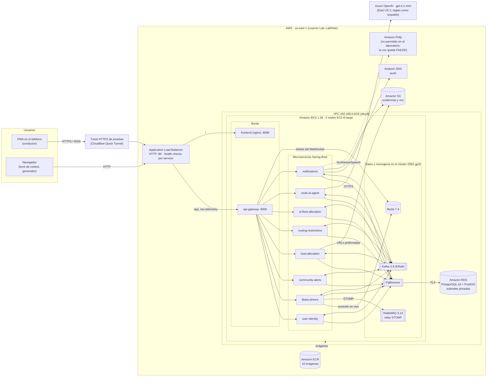
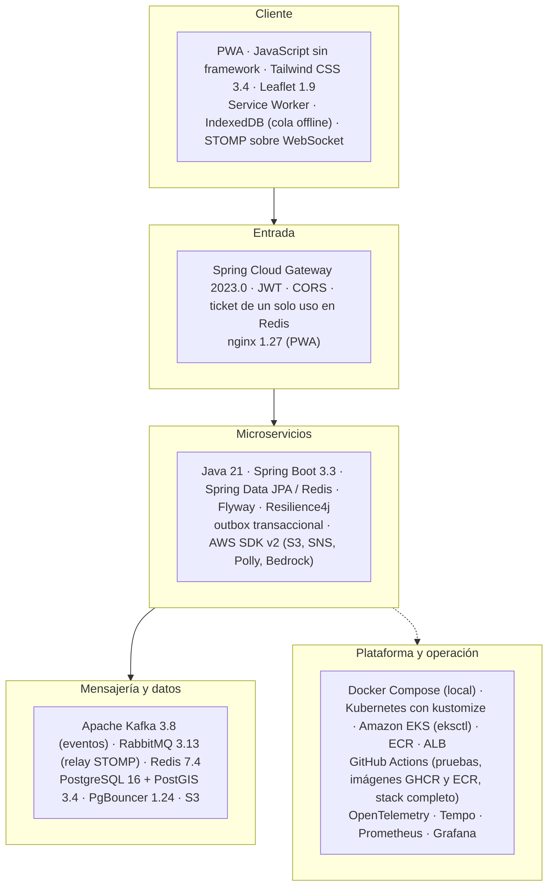
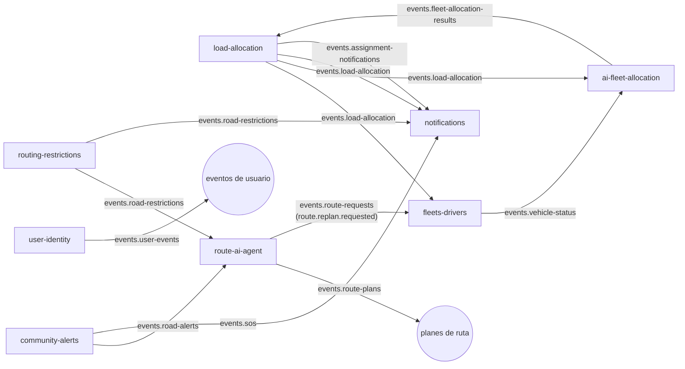
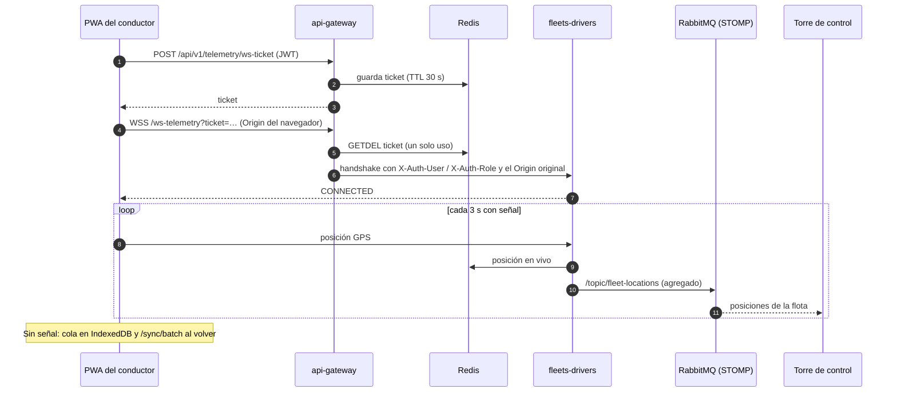
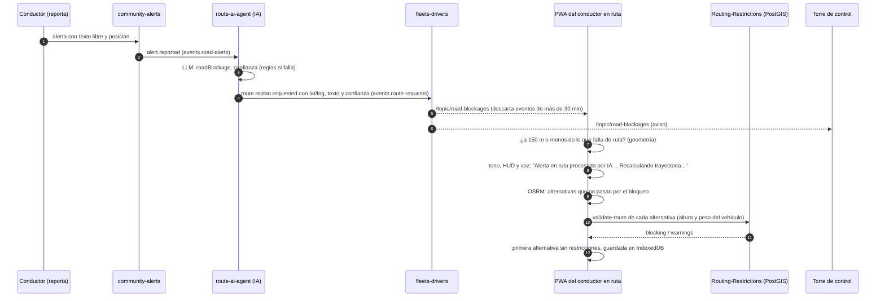

# Arquitectura de TruckCar

Cinco vistas de la plataforma tal como está hoy: el despliegue en AWS (EKS en AWS Academy Learner Lab), el stack por
capa, los eventos entre servicios, el flujo de la telemetría en vivo y la frontera entre la IA, el motor determinista y
la capa sin señal. La red local de Docker está en el
[README](../../README.md#topología-de-red) y el escalamiento en [ESCALAMIENTO_Y_ESTABILIDAD.md](ESCALAMIENTO_Y_ESTABILIDAD.md).

## 1. Despliegue en AWS (overlay `k8s/overlays/aws-eks-lab`)

- **Credenciales de AWS:** sin IRSA ni Pod Identity (el laboratorio no permite crear roles). Los pods usan el LabRole
  del nodo por IMDSv2 (hop limit 2) con `DefaultCredentialsProvider`. En el repositorio no hay claves.
- **Red:** NetworkPolicies con `default-deny` de entrada. El ALB llega solo a `:8000` del gateway, `:8080` de la PWA y
  `:8090` (health check del gateway). PgBouncer solo acepta a los servicios, y la mensajería solo a la plataforma.
- **HTTPS:** el laboratorio no permite CloudFront ni hay dominio para ACM. Para probar en el teléfono se usa el túnel
  (`k8s/overlays/aws-eks-lab/optional/cloudflare-tunnel.yaml`).
- **Ciclo de vida:** el desmontaje se hace con `scripts/teardown.sh`, en este orden: ALB, discos EBS, RDS y clúster.

## 2. Stack tecnológico por capa

## 3. Eventos entre servicios (Kafka)

Los tópicos llevan el prefijo `truckcar.`. Cada servicio publica con un outbox transaccional: el evento se guarda en
la misma transacción que el cambio y un publicador lo envía a Kafka.

## 4. Telemetría en vivo

## 5. Frontera entre la IA, el motor determinista y la capa sin señal

TruckCar usa un modelo de lenguaje en **un solo punto**: entender el texto libre de las alertas de la comunidad.
Las decisiones que pueden poner en riesgo un camión de carga pesada (a quién se asigna una carga, por dónde pasa y si
cabe bajo un puente) las toma código determinista sobre datos geográficos. El modelo solo informa: señala que la vía
está bloqueada. Si el modelo falla o no está disponible, el sistema sigue funcionando.

| Capa | Dónde vive | Qué decide | Qué **no** decide | Si falla |
|---|---|---|---|---|
| **IA (NLP)** | route-ai-agent: `ModelAlertInterpreter` con Azure OpenAI `gpt-4.1-mini` (Bedrock como alternativa) | Si el texto de una alerta describe un bloqueo (`roadBlockage`), su severidad y una confianza de 0 a 1. Solo con confianza ≥ 0,70 se pide replanteo | Rutas, asignaciones, gálibos ni pesos | Fallback a `RuleBasedAlertInterpreter` (palabras clave) con Resilience4j; métricas `truckcar_ai_requests_total` y `truckcar_ai_fallback_total` |
| **Motor determinista** | Routing-Restrictions (PostGIS: `validate-route`, `validate-compatibility`), AI-powered-fleet-allocation (`FleetScoringOptimizer`, `OsrmRouteRestrictionScreen`), OSRM, route-ai-agent (`TruckRoutePlanner` sobre HERE Routing v8 con perfil de camión) | Si una ruta es transitable para la altura y el peso del vehículo; a qué conductor se propone la carga (0,5·cercanía + 0,3·capacidad + 0,2·calificación, tras los filtros de cuenta verificada, ocupado, gálibo/peso de la ruta, RUNT, cadena de frío, tipo y capacidad); qué desvío se elige | La interpretación del texto libre | Fail-open documentado: sin Routing-Restrictions se asigna sin el filtro de ruta, con la métrica `component=route-restrictions`; la PWA avisa que la ruta no se pudo validar |
| **Capa sin señal** | PWA: `offlineQueue.js` (IndexedDB `truckcar-offline`), `routeStore.js` (`truckcar-route`), `tileStore.js` + Service Worker (teselas ya vistas, 100 MB) | Seguir guiando con la última ruta validada, avisar de gálibos a 3 km y de los puentes bajos vecinos fuera de ruta, encolar posiciones y entregas para `/sync/batch` | Nada nuevo: no recalcula rutas ni valida restricciones sin red, solo usa lo que el motor ya validó | Si no hay registro guardado, la guía queda como no disponible y el mapa sigue con las teselas en caché |

La explicación que ve la torre de control ("Asignado por algoritmo determinista (Cercanía + Capacidad +
Calificación)… Candidato ALT-410 descartado por gálibo/peso en la ruta (Límite: 3,80 m…)") la arma
`DecisionExplanation` a partir de los puntajes y motivos del optimizador. **No la escribe un LLM.** Se guarda en
`allocation_decisions.decision_explanation` y se devuelve en `GET /api/v1/fleet-allocation/history/{loadId}`.

### Ciclo del replanteo por bloqueo

La IA decide **si** hay un bloqueo. La geometría decide **a quién** afecta y PostGIS decide **por dónde** se puede
pasar. Si la IA se equivoca, un falso positivo cuesta un desvío validado y un falso negativo deja la ruta como
estaba. En ningún caso se manda un camión bajo un puente bajo.

### Qué queda en el dispositivo

| Almacén | Contenido | Vida |
|---|---|---|
| `truckcar-route` (`routeStore.js`) | Ruta elegida (geometría, maniobras), restricciones de la ruta, restricciones vecinas del corredor de 500 m, bloqueos marcados por la IA, la carga y el perfil del propio conductor | Se precalcula al aceptar y se actualiza al iniciar y en cada recálculo. Caduca a los 3 días y se borra al entregar o al cerrar sesión |
| `truckcar-offline` (`offlineQueue.js`) | Eventos pendientes (posiciones, inicio, entrega con firma y foto, alertas) | Hasta que `/sync/batch` los confirma |
| `truckcar-tiles` + caché del SW | Teselas que el conductor ya vio | Según las cabeceras de la tesela; tope de 100 MB. Por los términos de Stadia Maps no se precargan zonas |
