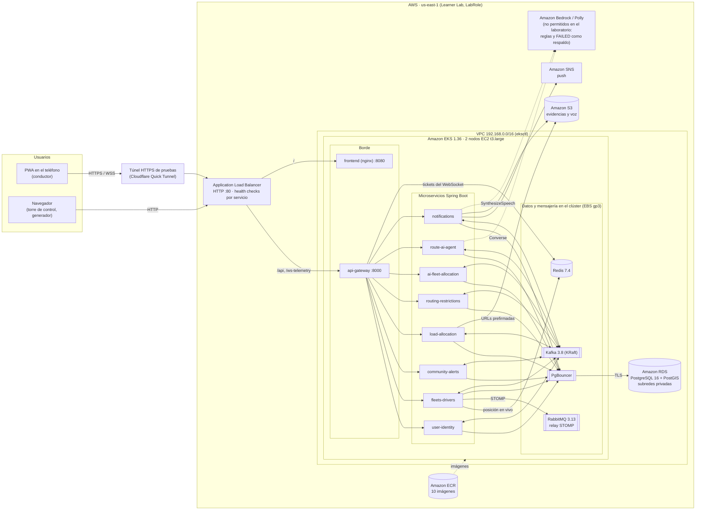
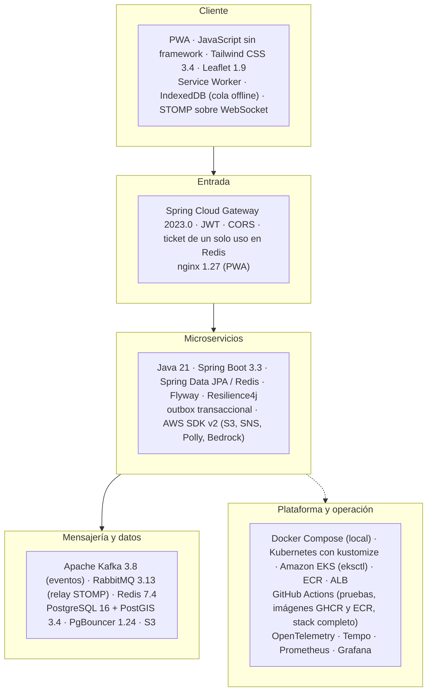
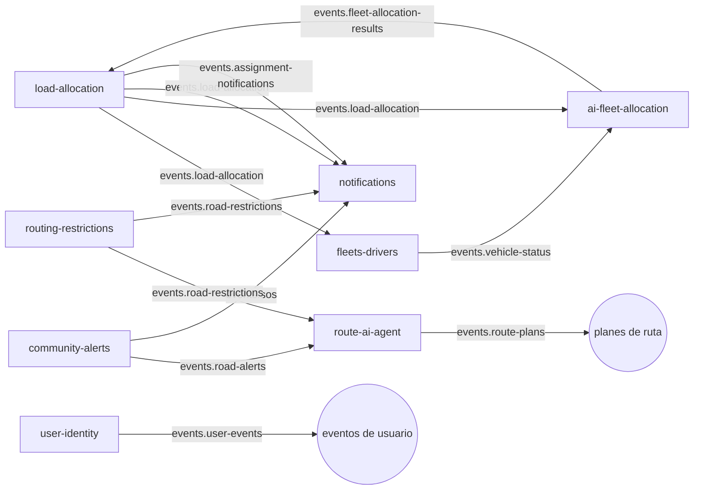
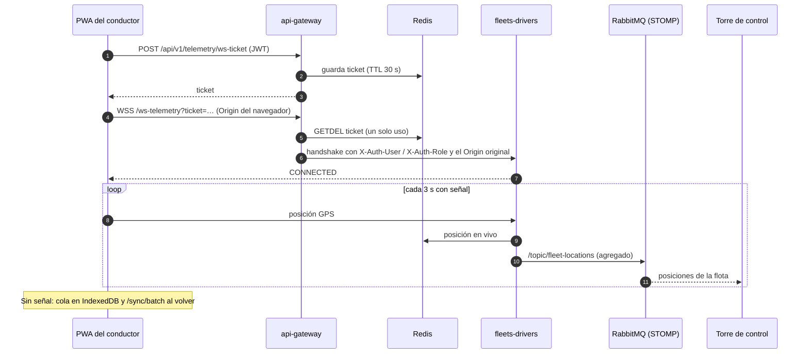

# Arquitectura de TruckCar

Cuatro vistas de la plataforma tal como está hoy: el despliegue en AWS (EKS en AWS Academy Learner Lab), el stack por
capa, los eventos entre servicios y el flujo de la telemetría en vivo. La red local de Docker está en el
[README](../../README.md#topología-de-red) y el escalamiento en [ESCALAMIENTO_Y_ESTABILIDAD.md](ESCALAMIENTO_Y_ESTABILIDAD.md).

## 1. Despliegue en AWS (overlay `k8s/overlays/aws-eks-lab`)

- **Credenciales de AWS:** sin IRSA ni Pod Identity (el laboratorio no permite crear roles). Los pods usan el LabRole
  del nodo por IMDSv2 (hop limit 2) con `DefaultCredentialsProvider`. En el repositorio no hay claves.
- **Red:** NetworkPolicies con `default-deny` de entrada. El ALB llega solo a `:8000` del gateway, `:8080` de la PWA y
  `:8090` (health check del gateway). PgBouncer solo acepta a los servicios, y la mensajería solo a la plataforma.
- **HTTPS:** el laboratorio no permite CloudFront ni hay dominio para ACM. Para probar en el teléfono se usa el túnel
  (`k8s/overlays/aws-eks-lab/optional/cloudflare-tunnel.yaml`).
- **Ciclo de vida:** el desmontaje se hace con `scripts/teardown.sh`, en este orden: ALB, discos EBS, RDS y clúster.

## 2. Stack tecnológico por capa

## 3. Eventos entre servicios (Kafka)

Los tópicos llevan el prefijo `truckcar.`. Cada servicio publica con un outbox transaccional: el evento se guarda en
la misma transacción que el cambio y un publicador lo envía a Kafka.

## 4. Telemetría en vivo

