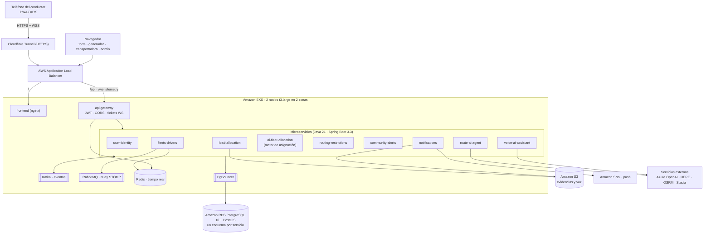
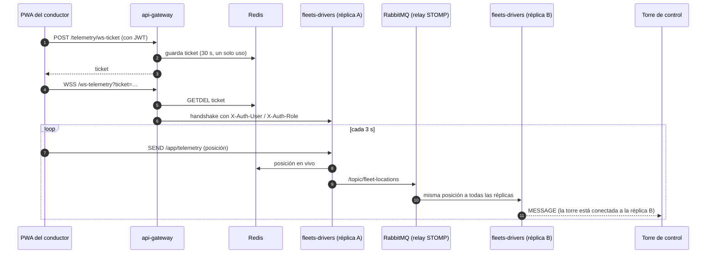
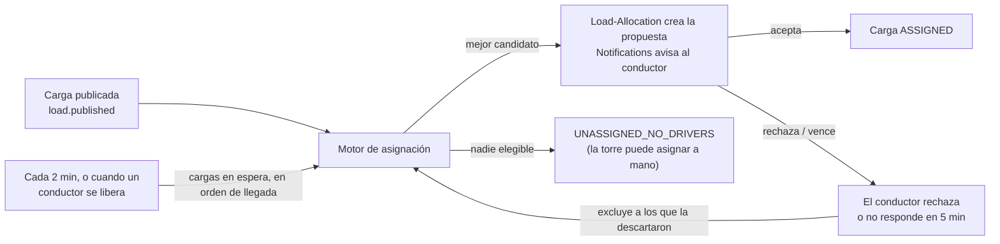
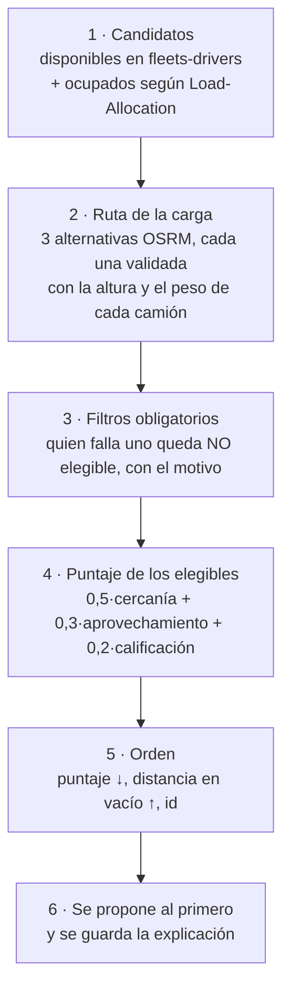
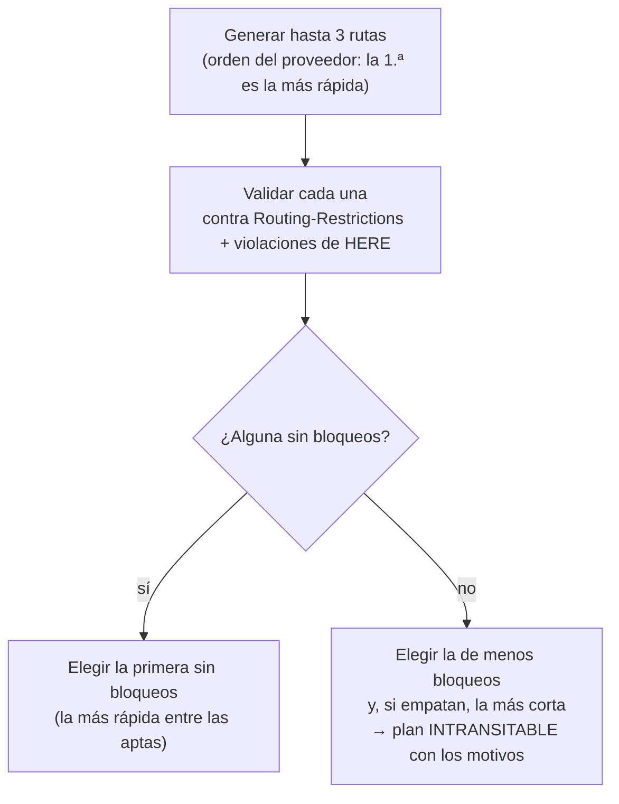
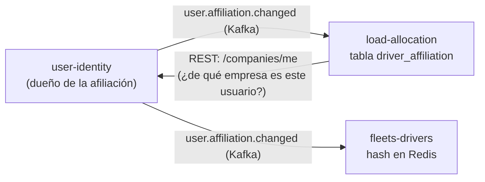

# TruckCar · Decisiones técnicas y algoritmos

Este documento justifica las decisiones de arquitectura de TruckCar: qué se eligió, qué alternativas se descartaron y
por qué. Explica también los dos algoritmos centrales de la plataforma: la **asignación de cargas** y la **elección de
rutas para camión**. Complementa a [ARQUITECTURA.md](ARQUITECTURA.md), con las vistas de despliegue y eventos, y a
[ESCALAMIENTO_Y_ESTABILIDAD.md](ESCALAMIENTO_Y_ESTABILIDAD.md). Cada afirmación cita el código donde se puede verificar.

**Premisa de diseño.** Los conductores trabajan en carretera, con celulares de gama media y señal intermitente:

> El teléfono solo captura, guarda y muestra. Todo cálculo costoso o compartido ocurre en la nube, y todo cálculo que
> afecta la seguridad del camión es determinista y verificable.

## Contenido

1. [Vista general](#1-vista-general)
2. [Comunicación entre componentes](#2-comunicación-entre-componentes)
3. [Tiempo real: por qué STOMP sobre WebSocket](#3-tiempo-real-por-qué-stomp-sobre-websocket)
4. [Asignación de cargas](#4-asignación-de-cargas)
5. [Rutas para camión](#5-rutas-para-camión)
6. [Bases de datos](#6-bases-de-datos)
7. [Balanceo de carga y disponibilidad](#7-balanceo-de-carga-y-disponibilidad)
8. [La PWA y la APK](#8-la-pwa-y-la-apk)
9. [Otras decisiones](#9-otras-decisiones)

---

## 1. Vista general



| Servicio | Responsabilidad | Datos propios |
|---|---|---|
| **api-gateway** | Única puerta de entrada. Valida el JWT, aplica CORS y límite de intentos de login, y reenvía con `X-Auth-User` y `X-Auth-Role`. Entrega los tickets del WebSocket | Redis |
| **user-identity** | Cuentas, login, JWT y refresh tokens, doble factor (TOTP), recuperación de contraseña, empresas transportadoras y afiliación de conductores | Esquema `user_identity` |
| **fleets-drivers** | Vehículos y estado de los conductores; telemetría en vivo por STOMP; Mi flota; conductores disponibles para el motor | Esquema `fleets_drivers` + Redis |
| **load-allocation** | Ciclo de vida de la carga: publicada → propuesta → aceptada → camino al cargue → en el cargue → recogida → entregada. Cargas propias y seguimiento público | Esquema `load_allocation` + S3 |
| **ai-fleet-allocation** | Motor determinista de asignación ([§4](#4-asignación-de-cargas)) | Esquema `fleet_allocation` |
| **routing-restrictions** | Puentes y restricciones de gálibo y peso; valida rutas ([§5](#5-rutas-para-camión)) | Esquema `routing_restrictions` |
| **community-alerts** | Alertas viales, SOS, SOS por empresa | Esquema `community_alerts` con PostGIS |
| **route-ai-agent** | Interpreta con IA el texto libre de las alertas; planes de ruta para camión con HERE; paradas sobre la ruta | Esquema `route_ai_agent` |
| **notifications** | Push por SNS, voz y correo | Esquema `notifications` + S3 |
| **voice-ai-assistant** | Traduce a órdenes de la app las frases del Copiloto de voz que las reglas del teléfono no entienden | Sin base propia |
| **frontend** | Sirve la PWA (nginx) | — |

---

## 2. Comunicación entre componentes

Hay tres mecanismos, y cada uno resuelve un tipo distinto de necesidad.

| Mecanismo | Cuándo se usa | Ejemplos |
|---|---|---|
| **REST síncrono** | Se necesita una respuesta en ese momento | La PWA llama por el gateway; el motor consulta los conductores disponibles (`fleets-drivers /active`) y los ocupados (`load-allocation /driver-commitments`); load-allocation y community-alerts confirman la empresa del usuario en `user-identity /companies/me` |
| **Eventos en Kafka** | Algo **pasó** y les interesa a otros servicios; no se puede perder | `load.published`, `trip.picked_up` y `trip.delivered` llegan al motor, a fleets-drivers y a notifications; `user.affiliation.changed` actualiza las copias locales de la afiliación |
| **STOMP sobre WebSocket** | Datos **en vivo** hacia y desde las pantallas | GPS del conductor, flota de la torre, línea de tiempo del generador, bloqueos detectados por la IA |

**Protecciones de las llamadas REST entre servicios:**
- timeouts (por ejemplo, el motor usa 2 s de conexión y 4 s de lectura);
- reintentos con backoff exponencial y jitter;
- circuit breaker con Resilience4j: hacia fleets-drivers y load-allocation en el motor, y hacia Azure OpenAI en la IA.

**Garantías de los eventos:**
- **Outbox transaccional:** el evento se guarda en la misma transacción que el cambio, así nunca queda un cambio sin su evento ni un evento sin su cambio.
- **Un solo publicador a la vez:** el publicador lo envía a Kafka, y `pg_try_advisory_xact_lock` evita que dos réplicas lo envíen dos veces (`*/repository/OutboxEventRepository.java`).
- **Reintentos y DLT:** un consumidor que falla reintenta 3 veces con backoff y después manda el mensaje a un tópico `*.DLT` para revisarlo.

---

## 3. Tiempo real: por qué STOMP sobre WebSocket

### El problema
- **El conductor envía y recibe a la vez:** manda su GPS cada 3 s (cada 15 s si está disponible sin carga) y al mismo tiempo recibe bloqueos de la IA, cambios de su carga y errores.
- **Las pantallas de seguimiento reciben en vivo:** la torre, la transportadora y el generador ven posiciones y estados.
- **Hay varias réplicas de fleets-drivers**, y el mensaje debe llegar aunque el teléfono y la torre estén conectados a réplicas distintas.
- **Cada pantalla debe recibir solo lo que le corresponde.**

### La solución
**WebSocket** como transporte, **STOMP** como protocolo de mensajería y **RabbitMQ** como *broker relay*.



### Alternativas descartadas

| Alternativa | Por qué no |
|---|---|
| **Polling** (preguntar cada N s) | Latencia de hasta N s y una petición HTTP completa (cabeceras y JWT) por cada posición. Con un envío cada 3 s por conductor, la carga crece muy rápido |
| **Server-Sent Events** | Es de una sola vía (servidor → cliente). El GPS tendría que ir aparte, con un POST cada 3 s |
| **WebSocket sin protocolo encima** | Da el canal, pero no dice cómo suscribirse a temas, a quién va cada mensaje ni cómo repartir entre réplicas: habría que inventar y mantener un protocolo propio |
| **MQTT** | Bueno para IoT, pero obliga a exponer otro broker a internet con su propia autenticación (el navegador igual lo usaría sobre WebSocket), y su integración con Spring y nuestro JWT es más débil |
| **Socket.IO** | Protocolo propio del ecosistema Node.js; no es estándar ni encaja con Spring |
| **Kafka hasta el cliente** | Kafka no es para navegadores: no habla WebSocket y sus consumidores son de backend |

### Qué aporta STOMP
- **Destinos con publicación y suscripción:**
  - `/topic/fleet-locations`: la flota para la torre;
  - `/topic/trip.{id}.status`: la línea de tiempo de una carga para su generador;
  - `/topic/road-blockages`: bloqueos detectados por la IA;
  - `/user/queue/errors`: mensajes privados de un usuario.
- **Autorización por destino:** `TelemetryAccessPolicy` en fleets-drivers decide quién puede suscribirse o publicar en cada destino. Un generador no puede escuchar la flota completa y un conductor no puede publicar la posición de otro. Hay pruebas de integración que lo verifican.
- **Soporte nativo en Spring** (`@MessageMapping`, interceptores, broker relay), sin código propio de mensajería.
- **Escala horizontal:** con un broker en memoria, cada réplica solo vería a sus clientes. El relay en RabbitMQ entrega cada mensaje a todas las réplicas.
- **Protocolo de texto simple:** el cliente de la PWA es una función de pocas líneas (`frame()` en `js/telemetry.js`), sin librería, y la app sigue liviana.

### Por qué RabbitMQ para esto y Kafka para los eventos
- **RabbitMQ** reparte mensajes **efímeros** a muchos suscriptores en vivo, y es el broker que Spring sabe usar como relay STOMP.
- **Kafka** es un **registro durable**: guarda los eventos, permite releerlos, cada servicio los lee con su propio grupo de consumidores y la partición conserva el orden por carga. Es lo correcto para «la carga cambió de estado», que no se puede perder.

### Seguridad del canal
- **El JWT nunca viaja en la URL:** los navegadores y proxys guardan las URLs en sus registros. Se usa un ticket de un solo uso que vive 30 s en Redis y se borra al usarse (`GETDEL`).
- **Se valida el `Origin`** de la conexión contra la lista de orígenes permitidos (`TRUCKCAR_WEBSOCKET_ALLOWED_ORIGINS`), en el gateway y en fleets-drivers.

---

## 4. Asignación de cargas

Lo hace **ai-fleet-allocation**. Es **determinista y explicable**: ningún modelo de IA decide a quién se asigna una carga.

### 4.1 Cuándo se ejecuta



- **Tiempo de respuesta del conductor:** 5 minutos (`truckcar.assignment.response-timeout-minutes`).
- **Intentos por ciclo:** máximo 5 (`truckcar.assignment.max-attempts`).
- **Reintento de cargas en espera:** cada 120 s (`WaitingLoadsRetryScheduler`), en orden de llegada.

### 4.2 El algoritmo, paso a paso



**Paso 1 · Candidatos.**
- De fleets-drivers: los conductores disponibles, con su posición real (llega por telemetría aunque no tengan carga), su camión y su afiliación.
- De Load-Allocation: quién está ocupado con otra carga o tiene una propuesta pendiente.

**Paso 2 · La ruta de la carga contra cada camión** (`service/route/OsrmRouteRestrictionScreen.java`).
1. OSRM da **hasta 3 rutas alternativas** entre el origen y el destino. Se guardan en memoria por carga, para no repetir la consulta en cada reintento.
2. Cada ruta se valida contra Routing-Restrictions ([§5.2](#52-validación-contra-restricciones)) con la altura y el peso bruto del camión: tara + lo que ya lleva + la carga.
3. El camión queda **incompatible solo si las 3 rutas fallan**: si existe un desvío apto, la navegación lo elegirá.
4. Si OSRM o Routing-Restrictions no responden, no se descarta a nadie (*fail-open*) y se cuenta en `truckcar_ai_fallback_total{component="route-restrictions"}`. No se inventa una incompatibilidad.

**Paso 3 · Filtros obligatorios** (`service/algorithm/FleetScoringOptimizer.java`):

| Filtro | Motivo que queda registrado (ejemplo) |
|---|---|
| Ocupado | «Conductor ocupado con la carga #3 (IN_TRANSIT)» |
| Carga propia de otra empresa | «Carga propia de Transportes Andinos: solo para sus conductores» |
| Cuenta sin verificar | «Cuenta del conductor sin verificar…» |
| Gálibo o peso en todas las rutas | «Incompatible por gálibo/peso en la ruta (Límite: 3,80 m, Vehículo: 4,10 m)» |
| RUNT vencido | «RUNT no vigente…» |
| Cadena de frío | Carga refrigerada y conductor sin certificación |
| Capacidad | Capacidad **disponible** (máxima − lo que ya lleva) menor que la carga |
| Tipo de camión | No coincide con el requerido |

**Paso 4 · Puntaje** (de 0 a 100):

```
puntaje = 100 × ( 0,50 · cercanía + 0,30 · aprovechamiento + 0,20 · calificación )

cercanía        = e^(−d / 200 km)      d: distancia Haversine del camión al punto de cargue
aprovechamiento = peso de la carga / capacidad disponible del camión
calificación    = estrellas del conductor / 5      (4,0 si no tiene)
```

| Distancia al cargue | Cercanía |
|---|---|
| 0 km | 1,00 |
| 50 km | 0,78 |
| 100 km | 0,61 |
| 300 km | 0,22 |
| 600 km | 0,05 |

**Por qué esa fórmula:**
- **La cercanía pesa la mitad** porque los kilómetros que el camión recorre **vacío** hasta el cargue son el mayor costo evitable: combustible, tiempo del conductor y emisiones.
- **Decaimiento exponencial y no lineal:** con un corte lineal (0 a partir de 300 km), un camión a 310 km empataba con uno a 900 km. La exponencial siempre distingue al más cercano.
- **El aprovechamiento** premia al camión del tamaño justo: no se compromete una tractomula de 34 t para 5 t si hay uno adecuado.
- **La calificación** desempata a favor de la calidad del servicio.

**Paso 5 · Orden** (`FleetScoringOptimizer.RANKING`): por puntaje de mayor a menor; si hay empate, el más cercano; si siguen empatados, el id del conductor. Así el resultado no depende del orden en que llegan los datos.

**Paso 6 · Explicación.** `DecisionExplanation` arma el texto que ve la torre («Asignado por algoritmo determinista… candidato X descartado por…») a partir de los puntajes y los motivos. **No lo escribe un LLM.** Se guarda y se consulta en `GET /fleet-allocation/history/{loadId}`.

### 4.3 Por qué un algoritmo greedy y no el algoritmo húngaro

El **algoritmo húngaro** (Kuhn–Munkres) resuelve el *problema de asignación*: dadas *n* cargas y *m* conductores **al mismo tiempo**, encuentra el emparejamiento que minimiza el costo total, en O(n³). En TruckCar hoy no encaja, por tres razones:

1. **Las cargas llegan de a una (es un problema *online*).** Casi siempre hay una sola carga pendiente. Con una sola fila en la matriz, el húngaro da exactamente el mismo resultado que elegir el mejor puntaje, que cuesta O(m).
2. **Una asignación es solo una propuesta.** El conductor puede rechazarla o no responder. Un óptimo global calculado ahora se invalida con el primer rechazo.
3. **Explicabilidad.** La torre necesita ver por qué se eligió a cada conductor y por qué se descartó a los demás. Con un puntaje por candidato es directo; en un óptimo global, la decisión de una carga depende de todas las demás.

**Limitación del greedy:** si llegan varias cargas casi a la vez, la primera se lleva al conductor más cercano aunque una segunda lo necesitara más (decisión «miope»).

**Cuándo convendría el húngaro:** con un volumen alto de cargas simultáneas. Se acumularían las cargas en una ventana corta (por ejemplo 30 a 60 s) y se armaría la matriz:
- costo = 1 − puntaje;
- costo infinito donde un filtro descarta al conductor.

El húngaro daría el mejor emparejamiento conjunto. El cambio quedaría contenido en el motor: los filtros y el puntaje se reutilizan tal cual.

---

## 5. Rutas para camión

Hay dos capas: **quién calcula los caminos** y **cómo los elegimos y protegemos**.

### 5.1 Cálculo de caminos
No implementamos Dijkstra: usamos motores de rutas especializados sobre el mapa vial completo.

| Motor | Rol | Cómo calcula |
|---|---|---|
| **HERE Routing v8** con perfil de camión | Principal (route-ai-agent `TruckRoutePlanner` y la navegación) | Considera altura, peso y ejes, y devuelve las **violaciones** de restricciones del vehículo en cada ruta |
| **OSRM** | Respaldo, y rutas del motor de asignación | Dijkstra acelerado con preprocesamiento del grafo vial (*Contraction Hierarchies* o *Multi-Level Dijkstra*): responde en milisegundos sobre todo OpenStreetMap |

**Por qué no Google Maps:** su API de rutas no tiene perfil de camión con gálibo y peso, que es justamente lo crítico en carga pesada. HERE sí lo tiene, y OSRM es abierto y gratuito.

### 5.2 Validación contra restricciones
Lo hace **Routing-Restrictions**, `POST /restrictions/validate-route`, en `RoadRestrictionService.validateRoute`:

1. **Prefiltro en la base de datos:** una consulta SQL trae solo las restricciones activas dentro del **rectángulo** que envuelve la ruta, más el margen del corredor (`findActiveWithin`). Así no se revisa todo el país.
2. **Cálculo exacto en la aplicación:** cada restricción se **proyecta sobre la polilínea** de la ruta, para saber a qué distancia queda de la ruta y en qué punto del recorrido.
3. **Clasificación** de las restricciones a **60 m o menos** de la ruta (corredor por defecto):
   - **bloqueante**, si el camión excede el límite de altura o peso;
   - **advertencia**, si no lo excede (se avisa igual).
4. **Resultado:** `passable`, la lista de bloqueos y advertencias ordenadas por su posición en la ruta, y a cuántos metros del inicio está cada una. Con eso la navegación avisa los gálibos **3 km antes**.

**Limitación conocida** (está en el código): una restricción es un punto, sin calzada ni sentido. Un puente que pasa **sobre** la ruta y la vía que pasa **por debajo** se ven igual de cerca. Por eso el corredor es corto: 60 m.

### 5.3 Elección de la ruta: generar alternativas y validar



Es la misma regla en el backend (`TruckRoutePlanner.plan`) y en el teléfono (`chooseRoute` en `js/navigation.js`). Además, las alertas de la comunidad a **menos de 2 km** de la ruta elevan su riesgo; un derrumbe o un accidente lo sube a ALTO.

### 5.4 Optimización durante el viaje

| Situación | Qué hace la navegación (`js/navigation.js`) |
|---|---|
| El camión se sale de la ruta (más de **250 m**) | Recalcula desde la posición actual, pasando por las paradas pendientes, con un intervalo mínimo de **30 s** entre recálculos |
| La IA detecta un bloqueo con **confianza ≥ 0,70** (`RouteEventListener.MIN_REPLAN_CONFIDENCE`) a **150 m o menos** de lo que falta de ruta | Pide alternativas que **eviten un radio de 300 m** del bloqueo; si no hay, fuerza desvíos con puntos laterales (~3 km a cada lado). Valida cada alternativa con [§5.2](#52-validación-contra-restricciones) y, si el desvío suma más de **5 min o 5 km**, **le pregunta al conductor** antes de tomarlo |
| El conductor pide un restaurante, hotel o estación | Busca en HERE y OpenStreetMap en los próximos **60 km** de la ruta, con el **desvío real** para el camión (máximo **5 km**), y propone los 3 mejores |
| El viaje empieza lejos del punto de cargue | El cargue queda como parada obligatoria; con otras paradas, se ordenan por su posición sobre la ruta: **aquí → restaurante → cargue → destino** |

### 5.5 Dónde está la IA y dónde no

| Capa | Decide | No decide |
|---|---|---|
| **IA** (Azure OpenAI `gpt-4.1-mini`; reglas por palabras clave si falla) | **Si** el texto de una alerta describe un bloqueo, y con qué confianza | Rutas, asignaciones, gálibos ni pesos |
| **Geometría** (navegación) | **A quién** afecta el bloqueo: a los camiones cuya ruta restante pasa a ≤ 150 m | — |
| **Routing-Restrictions** | **Por dónde** puede pasar cada camión | — |

Un falso positivo de la IA cuesta un desvío ya validado; un falso negativo deja la ruta como estaba. En ningún caso un error del modelo manda un camión bajo un puente bajo.

---

## 6. Bases de datos

### 6.1 Qué se usa y por qué

| Almacén | Qué guarda | Por qué ese |
|---|---|---|
| **PostgreSQL 16** (Amazon RDS) | Todo lo transaccional: cuentas, cargas, vehículos, alertas, restricciones, decisiones, notificaciones | El ciclo de una carga necesita **transacciones ACID** y **bloqueo optimista** (`@Version` en `FreightLoad`), para que dos acciones simultáneas no la dejen en un estado imposible. Es gestionado en AWS (copias de 7 días, cifrado) y tiene PostGIS |
| **PostGIS** | Ubicación de las alertas viales | `ST_DWithin` con índice espacial responde en la base: (1) **deduplicar reportes**: si ya existe una alerta del mismo tipo cerca y reciente, el reporte suma una confirmación a esa alerta (una por conductor) en vez de crear otra, y al llegar al umbral la alerta queda validada; (2) **alertas cercanas** a una posición (`RoadAlertRepository`) |
| **Redis 7.4** | Posición en vivo, tickets del WebSocket, límite de intentos de login, afiliaciones en memoria | La posición cambia cada 3 s y los tickets viven 30 s: en Postgres serían escrituras inútiles. Redis responde en microsegundos y borra solo con el TTL |
| **Apache Kafka 3.8** | Eventos entre servicios (3 particiones por tópico) | Durable, se puede releer, cada servicio consume con su propio grupo y absorbe picos y caídas de los consumidores |
| **RabbitMQ 3.13** | Solo el relay STOMP | Ver [§3](#3-tiempo-real-por-qué-stomp-sobre-websocket) |
| **Amazon S3** | Firmas, fotos de entrega y audio | Los binarios no inflan la base, y el teléfono sube directo a S3 con una **URL prefirmada**, sin pasar el archivo por el backend |
| **IndexedDB** (teléfono) | Cola sin señal y ruta guardada | Sobrevive a cerrar la app y no bloquea la interfaz |

**Por qué no MongoDB u otra NoSQL:** el dominio es relacional (una carga tiene conductor, generador, empresa, hitos y evidencias) y necesita transacciones y restricciones de integridad. Lo que sí es efímero o de alta frecuencia ya está en Redis.

### 6.2 Una base por servicio

Hay **una sola instancia de RDS** (por costo del laboratorio), pero **cada servicio tiene su propio esquema y su propio usuario** de base de datos (`docker/postgres/init-service-schemas.sql`):

`user_identity` · `load_allocation` · `fleets_drivers` · `community_alerts` · `routing_restrictions` · `fleet_allocation` · `route_ai_agent` · `notifications`

- **Ningún servicio puede leer el esquema de otro:** su usuario solo tiene permisos sobre el suyo.
- **Cada servicio versiona su esquema con Flyway** (por ejemplo, Load-Allocation va en la V9).
- **Cualquier esquema puede pasar a su propia instancia** sin tocar código. Es el patrón *database per service* al costo de una sola instancia.

### 6.3 Cómo se comunican los datos entre servicios

Como ningún servicio consulta la base de otro, los datos se mueven de dos formas:



1. **Consulta en el momento (REST):** cuando hace falta el dato vigente y verificado con el token del usuario. Por ejemplo, la empresa de quien pide sus cargas.
2. **Copia local alimentada por eventos (Kafka):** cuando el dato se consulta muy seguido. Por ejemplo, load-allocation decide si una carga propia es para un conductor sin llamar a user-identity en cada propuesta.

**Consistencia:** es **eventual**; la copia se actualiza en milisegundos o segundos. Las reglas críticas las valida además el servicio dueño de la decisión: aunque el motor se equivocara, load-allocation responde **409** si se le propone una carga propia a un conductor de otra empresa.

### 6.4 Conexiones
- **PgBouncer** en modo *transaction* recibe hasta 1.000 conexiones de los servicios y las concentra en un pool de 10 por base hacia RDS.
- **Hikari** usa 5 conexiones por pod.

Sin PgBouncer, al escalar las réplicas se agotarían las conexiones de RDS.

---

## 7. Balanceo de carga y disponibilidad

### 7.1 Balanceo, capa por capa

| Capa | Cómo reparte |
|---|---|
| **ALB → pods** | Envía directo a la IP de cada pod (`target-type: ip`) y solo a los que pasan su health check (`/actuator/health/readiness` en el gateway, `/healthz` en la PWA) |
| **api-gateway → servicios** | `lb://servicio` con el DNS de Kubernetes: reparte entre las réplicas de cada servicio |
| **WebSocket** | `fleets-drivers` es un Service *headless*: el gateway ve cada réplica y reparte las conexiones STOMP. RabbitMQ entrega cada mensaje a todas |
| **Kafka** | 3 particiones por tópico: con varias réplicas, cada mensaje lo procesa una sola, en paralelo y en orden por carga |
| **Base de datos** | PgBouncer concentra las conexiones |
| **Autoescalado (HPA)** | gateway, fleets-drivers y frontend escalan por CPU (70 %); en el laboratorio, hasta 3 réplicas por la capacidad de los nodos |

### 7.2 Disponibilidad

| Mecanismo | Qué protege |
|---|---|
| **2 réplicas, una por nodo y zona**, en la ruta crítica (gateway, user-identity, fleets-drivers, PgBouncer, frontend) | Si cae un nodo o una zona, el login, la entrada, la telemetría y la PWA siguen |
| **PodDisruptionBudget** (`minAvailable: 1`) | Un mantenimiento o drenado nunca baja todas las réplicas a la vez |
| **Rolling update** (surge 1, unavailable 0) | Desplegar una versión nueva no corta el servicio |
| **Probes** de startup, liveness y readiness | Se reinicia lo que se cuelga y no se envía tráfico a lo que no está listo |
| **Apagado ordenado** (`preStop` de 10 s + 25 s de graceful shutdown) | Un reinicio termina las peticiones en curso |
| **Circuit breaker, timeouts y reintentos** | Un vecino lento no tumba al resto |
| **Fallbacks** | Sin IA → reglas. Sin validación de ruta → se asigna y se avisa. Sin Stadia → mapa de Esri |
| **Kafka como colchón** | Un servicio caído procesa sus eventos al volver |
| **Outbox e idempotencia** (`clientEventId`, tablas `ingested_events`) | Nada se pierde ni se duplica ante reintentos |
| **Modo sin señal en el teléfono** | El conductor sigue navegando y registrando aunque se caiga la red o la nube |
| **Copias de RDS de 7 días** | Recuperación ante errores |

### 7.3 Puntos débiles reconocidos

| Punto único de falla | Solución en un entorno productivo |
|---|---|
| RDS en una sola zona | `-var rds_multi_az=true` en Terraform |
| Un solo NAT gateway | Un NAT por zona |
| Kafka, Redis y RabbitMQ con una réplica en el clúster | Amazon MSK, ElastiCache y Amazon MQ (el overlay `aws-eks` ya los contempla) |
| Cloudflare Quick Tunnel sin SLA y con URL cambiante | Dominio propio con certificado de ACM en el ALB |
| El Learner Lab apaga todo al cerrar la sesión | Una cuenta de AWS sin las restricciones del laboratorio |

---

## 8. La PWA y la APK

| Tecnología | Para qué | Por qué |
|---|---|---|
| **HTML, CSS y JavaScript sin framework** | Toda la interfaz | Celulares de gama media con mala señal: menos peso, memoria y batería que React o Angular. Se instala sin tienda de aplicaciones |
| **Tailwind CSS 3.4** | Estilos | Se compila al desplegar (~20 KB), no en el teléfono |
| **Leaflet 1.9** + teselas de **Stadia Maps** | Mapa | Más liviano que Google Maps JS, sin costo por carga de mapa, con modo claro y oscuro. Si Stadia falla, pasa solo a Esri |
| **Service Worker** | La app abre sin red; teselas ya vistas en caché (tope 100 MB) | En carretera se pierde la señal |
| **IndexedDB** | Cola sin señal (`truckcar-offline`) y ruta guardada (`truckcar-route`) | Lo que el conductor registra sin señal se envía en lotes de hasta 100 eventos al volver, con backoff exponencial y jitter, sin duplicados (`clientEventId`). La última ruta validada sigue guiando sin red |
| **STOMP sobre WebSocket** | Telemetría y estados en vivo | [§3](#3-tiempo-real-por-qué-stomp-sobre-websocket) |
| **Copiloto de voz** | Órdenes habladas sin soltar el volante | Reconocimiento en el teléfono (Web Speech API, o nativo y **Vosk sin internet** en la APK). Primero las reglas locales; la IA solo cuando no entienden |
| **Capacitor** | APK de Android | Reutiliza el 100 % de la PWA y agrega lo que el navegador no da bien: voz nativa y sin internet, y el GPS del sistema |

---

## 9. Otras decisiones

| Decisión | Alternativas | Justificación |
|---|---|---|
| **Microservicios** | Monolito | Cada dominio evoluciona, se despliega y escala por separado. La telemetría escala sin arrastrar al resto, y una falla en notificaciones no detiene las asignaciones |
| **Java 21 + Spring Boot 3.3** | Node.js, Go | Ecosistema maduro para lo que se necesita: JPA y Flyway, Kafka, STOMP, Resilience4j, Spring Cloud Gateway, seguridad y métricas |
| **API Gateway** | Que la PWA llame a cada servicio | Un solo punto valida el JWT, aplica CORS y límite de intentos, y entrega los tickets del WebSocket. Los servicios internos no se exponen a internet |
| **Kafka + outbox** | REST para todo; RabbitMQ para los eventos | Los eventos de negocio no se pueden perder y los leen varios servicios ([§2](#2-comunicación-entre-componentes)) |
| **IA solo para interpretar texto** | Que la IA decida rutas o asignaciones | Las decisiones que afectan la seguridad deben ser verificables y repetibles ([§5.5](#55-dónde-está-la-ia-y-dónde-no)) |
| **Azure OpenAI** | Amazon Bedrock | El Learner Lab no permite Bedrock ni Polly; la llamada sale por internet y no depende de los permisos de AWS |
| **Amazon EKS (Kubernetes)** | ECS, máquinas virtuales | Réplicas, autoescalado, rollouts sin caída y autosanación estándar. Los mismos manifiestos sirven para AWS y Azure (Kustomize) |
| **Terraform** | Crear todo a mano o con scripts | La infraestructura queda como código revisable y repetible: el laboratorio se recrea igual en ~20 min |
| **GitHub Actions** | Despliegue manual | Pruebas en cada PR; al fusionar en `main` se publica la imagen en ECR (`ecr-image.yml`, o las 11 a la vez con `ecr-all.yml`) |
