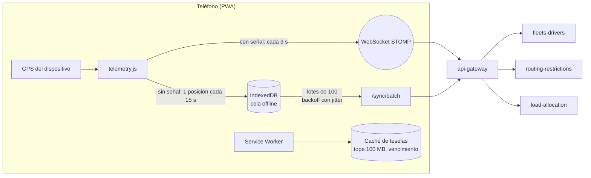
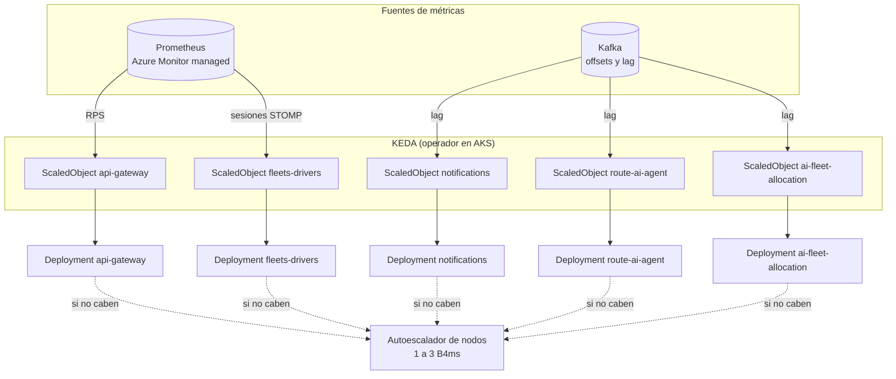

# TruckCar · Escalamiento y estabilidad

Documento de arquitectura para la sustentación. Estado a 2 de noviembre de 2026, ramas `main` de los repositorios de
TRUCKCAR-APP.

**Cómo leerlo:**
- Cada afirmación sobre el sistema actual lleva la ruta del archivo que la demuestra.
- Lo que todavía no existe está marcado como **propuesta** o **ausente**.
- Las rutas son relativas a la carpeta de cada repositorio:
  - `untitled/` es `truckcar-frontend`.
  - `k8s/` y `docker/` son de `Deployment-Infrastructure`.

---

## 1. Resumen ejecutivo y premisa de diseño

TruckCar se usará en carretera, desde teléfonos de gama media y baja, con señal intermitente. De ahí sale la premisa:

> **El teléfono solo captura, guarda y muestra. Todo cálculo costoso o compartido ocurre en la nube.**

| Decisión | Por qué |
|---|---|
| **PWA liviana** (HTML, CSS y JavaScript, sin framework en el cliente) | Menos memoria y menos batería; se instala sin tienda de aplicaciones |
| **Cálculo en la nube** | El gálibo y el peso sobre la ruta (Routing-Restrictions), la interpretación de alertas con IA (Route-AI-agent) y la asignación de conductores (AI-powered-fleet-allocation) corren en Kubernetes, no en el teléfono |
| **Sin señal, nada se pierde** | Lo que el conductor hace sin cobertura se guarda en el teléfono y se envía por lotes al reconectar |
| **La nube absorbe los picos** | El escalamiento se dispara por **tráfico y eventos** (conexiones, peticiones por segundo, mensajes en cola), no solo por la CPU |

**Tres hallazgos del análisis que este documento convierte en trabajo pendiente:**
1. **La ruta no se calcula en nuestra nube.** La PWA consulta el servidor público de demostración de OSRM
   (`untitled/js/navigation.js:13`). Es de terceros, sin garantía y con límites de uso.
2. **Falta la métrica de conexiones WebSocket** que necesita el escalado de `fleets-drivers`.
3. **La reconexión del WebSocket no tiene jitter** (`untitled/js/telemetry.js:91`). Si se reinicia un pod, todos los
   teléfonos reconectan al mismo tiempo: un pico sincronizado de reconexiones.

---

## 2. Arquitectura de la PWA liviana (optimizaciones del cliente)



### 2.1 Lo que ya está implementado

| Optimización | Detalle | Evidencia |
|---|---|---|
| Cola offline en IndexedDB | API asíncrona: guardar no bloquea la interfaz. La cola sobrevive al cierre de la app. | `untitled/js/offlineQueue.js` |
| Envío por lotes | Hasta **100 eventos por petición** a `/sync/batch` de cada servicio; el servidor acepta hasta 200 | `untitled/js/offlineQueue.js:17`, `fleets-drivers/.../sync/SyncBatchRequest.java:30` |
| Backoff exponencial con jitter | "Equal jitter": entre la mitad y el total de 2 s × 2ⁿ, con tope de 5 min. Se reinicia al volver la red. | `untitled/js/offlineQueue.js:207` y `:299` |
| Muestreo sin señal | Sin cobertura se guarda **una posición cada 15 s**, no cada 3 s: la cola crece 5 veces más despacio | `untitled/js/telemetry.js:372` |
| Ingesta idempotente | Cada evento lleva `clientEventId`, y el servidor descarta los repetidos al reenviar un lote | `fleets-drivers/.../sync/IngestionLedger.java` (también en Load-Allocation y Community-Alerts) |
| Caché de mapa acotada | **Tope de 100 MB** y vencimiento según las cabeceras del proveedor (7 días por defecto). Se expulsan primero las teselas vencidas y luego las menos usadas. Solo se guarda lo visto; nunca precarga. | `untitled/js/tileStore.js:18-19`, `untitled/sw.js` |
| Sin framework ni compilación en el cliente | Tailwind se compila en el despliegue (≈20 KB) y no en el teléfono | `untitled/css/tailwind.css`, `untitled/Dockerfile` |

### 2.2 Hoja de ruta del cliente

| Mejora | Problema que resuelve | Dónde |
|---|---|---|
| **OSRM propio en AKS**, detrás del gateway | Hoy el teléfono llama a `router.project-osrm.org` (`untitled/js/navigation.js:13`, `untitled/js/mapController.js:347`, `untitled/js/telemetry.js:271`): un servidor público, sin acuerdo de servicio y con límites de uso. Con un OSRM propio (extracto de Colombia, perfil de camión) las rutas pasan a ser nuestras y se pueden cachear. | Nuevo Deployment `osrm` y ruta `/api/v1/routing/**` en el gateway |
| **Proyección GPS acotada** | Con cada lectura de GPS el teléfono busca el tramo más cercano entre todos los puntos de la ruta (≈5.000 en Bogotá → Ibagué). Buscar solo cerca del último tramo conocido baja el costo de O(n) a casi O(1). | `untitled/js/navigation.js`, función `project` |
| **Jitter en la reconexión del WebSocket** | Hoy reconecta a los 2, 4, 8 y 15 s exactos (`untitled/js/telemetry.js:91-93`). Con jitter, los teléfonos no llegan todos en el mismo segundo tras un reinicio. | `untitled/js/telemetry.js` |
| **Respetar `429` y `Retry-After`** | Cuando el gateway limite la tasa (§4), la cola offline debe esperar lo que indique el servidor | `untitled/js/offlineQueue.js` |

**Límite honesto:** dibujar el mapa (Leaflet y las teselas) cuesta en el teléfono, escale lo que escale la nube.
Escalar en AKS mejora la latencia del servidor y la llegada de respuestas, no la fluidez de la pantalla. Esa la cuidan
la caché de teselas, el tema oscuro sin efectos y la ausencia de framework.

---

## 3. Escalamiento basado en eventos en Azure AKS (KEDA y HPA)

### 3.1 Por qué no basta el HPA por CPU

- **El tráfico dominante es la telemetría:** cada camión en ruta envía su posición **cada 3 s** por WebSocket
  (`untitled/js/telemetry.js:436`).

| Camiones en ruta | Mensajes por segundo | Conexiones WebSocket |
|---|---|---|
| 100 | ≈33 | 100 |
| 1.000 | ≈333 | 1.000 |
| 5.000 | ≈1.667 | 5.000 |

- **Por qué la CPU no avisa a tiempo:**
  - Un pod que reenvía mensajes y mantiene conexiones abiertas se satura en **conexiones, hilos y memoria** antes que en
    CPU.
  - Los consumidores de Kafka se atrasan (**lag**) sin que su CPU suba.
  - Un HPA por CPU reacciona tarde, o no reacciona.
- **El HPA actual:**
  - Solo cubre 3 cargas de trabajo y solo por CPU al 70 %: gateway de 2 a 6, fleets-drivers de 2 a 8 y frontend de 2 a 4
    (`k8s/base/autoscaling.yaml`).
  - user-identity tiene 2 réplicas fijas (login y renovación de tokens) y el resto 1 réplica fija.

### 3.2 Diseño propuesto con KEDA

KEDA es un complemento de AKS sin costo (`az aks update --enable-keda`). Crea y administra el HPA a partir de métricas
externas. Se mantiene la CPU como disparador de respaldo.



### 3.3 Métricas de KEDA por microservicio

| Servicio | Disparador | Consulta o parámetro | Umbral inicial | Réplicas | Requisito previo |
|---|---|---|---|---|---|
| `api-gateway` | Prometheus: **RPS** | `sum(rate(http_server_requests_seconds_count{application="ms-api-gateway"}[1m]))` | 150 RPS por réplica | 1 a 6 | La métrica ya se expone (`api-gateway/src/main/resources/application.yaml:110`). Falta un Prometheus consultable por KEDA. |
| `fleets-drivers` | Prometheus: **sesiones STOMP activas** | `sum(truckcar_websocket_sessions_active)` *(métrica nueva)* | 400 sesiones por réplica | 1 a 8 | **Ausente:** hay que publicar un gauge de Micrometer con las sesiones (`SimpUserRegistry`). El escalado horizontal ya está resuelto con el Service headless y el relay RabbitMQ (`k8s/base/apps/fleets-drivers.yaml`). |
| `notifications` | **Kafka lag** | grupos `notifications-group` y `notifications-group-high-priority` | `lagThreshold: 50` | 1 a 3 | Con 3 particiones, más de 3 consumidores por tópico quedan ociosos |
| `route-ai-agent` | **Kafka lag** | grupo `route-ai-agent-group`, tópicos `road-alerts` y `route-requests` | `lagThreshold: 20` (cada mensaje puede llamar a Azure OpenAI) | 1 a 3 | Igual que el anterior |
| `ai-fleet-allocation` | **Kafka lag** | grupo `fleet-allocation-group` | `lagThreshold: 20` | 1 a 3 | **Candado distribuido:** su reintento programado (`.../service/WaitingLoadsRetryScheduler.java:25`) no tiene candado. Con 2 réplicas, las dos reintentarían las mismas cargas. Usar `pg_try_advisory_xact_lock`, como el outbox (`load-allocation/.../repository/OutboxEventRepository.java:23`). |
| Resto (`user-identity`, `community-alerts`, `routing-restrictions`, `load-allocation`) | CPU (HPA) | `averageUtilization: 70` | — | 1 a 3 | `load-allocation` ya es seguro con varias réplicas: outbox con candado y `@Version` (`.../model/FreightLoad.java:150`) |

**Ejemplo para el gateway** (propuesta; no está en el repositorio):

```yaml
apiVersion: keda.sh/v1alpha1
kind: ScaledObject
metadata:
  name: api-gateway
  namespace: truckcar
spec:
  scaleTargetRef:
    name: api-gateway
  minReplicaCount: 1          # nunca a cero: el gateway es la puerta de entrada
  maxReplicaCount: 6
  cooldownPeriod: 300
  advanced:
    horizontalPodAutoscalerConfig:
      behavior:
        scaleDown:
          stabilizationWindowSeconds: 300   # evita subir y bajar en ráfagas cortas
  triggers:
    - type: prometheus
      metadata:
        serverAddress: https://<workspace>.prometheus.monitor.azure.com
        query: sum(rate(http_server_requests_seconds_count{application="ms-api-gateway"}[1m]))
        threshold: "150"
      authenticationRef:
        name: azure-managed-prometheus   # Workload Identity; sin claves en el repositorio
    - type: cpu
      metricType: Utilization
      metadata:
        value: "70"
```

**Ejemplo para un consumidor de Kafka:**

```yaml
  triggers:
    - type: kafka
      metadata:
        bootstrapServers: kafka.truckcar.svc:9092
        consumerGroup: route-ai-agent-group
        topic: truckcar.events.road-alerts
        lagThreshold: "20"
        allowIdleConsumers: "false"   # no crear más consumidores que particiones
```

### 3.4 Matices de resiliencia del escalamiento

| Matiz | Riesgo | Medida |
|---|---|---|
| **Particiones como techo** | Todos los tópicos tienen **3 particiones** (`docker-compose.yml`, servicio `kafka-init`). Escalar consumidores por lag no sirve más allá de 3 por grupo. | Subir a 6-12 particiones `truckcar.events.load-allocation` y `truckcar.events.vehicle-status` **antes** de activar KEDA, manteniendo la clave por carga para conservar el orden de cada viaje |
| **Bajar réplicas corta conexiones WebSocket** | Al reducir réplicas de `fleets-drivers` se cortan las conexiones de esos pods | `preStop` con unos segundos de espera, `terminationGracePeriodSeconds` amplio, ventana de 5 min antes de bajar, y jitter en la reconexión del cliente (§2.2) |
| **Pico sincronizado tras reiniciar** | Sin jitter, 1.000 teléfonos reconectan juntos | Jitter en el cliente y límite de tasa en el gateway (§4) |
| **La base de datos como cuello de botella** | Cada réplica abre hasta 5 conexiones Hikari (`k8s/base/platform-config.yaml:12`). Postgres B1ms admite pocas conexiones. | PgBouncer en modo `transaction` con un pool de 10 por base (`k8s/base/data/pgbouncer.yaml:16-20`) ya las multiplexa. Revisar `max_connections` del plan antes de escalar. |
| **Subir y bajar en ráfagas** | Escalar y desescalar seguido gasta crédito y corta conexiones | `stabilizationWindowSeconds` y `cooldownPeriod` en cada ScaledObject |

---

## 4. Inventario de estabilidad y componentes

**Leyenda:** ✅ implementado · 🟡 parcial · ❌ ausente. Sin evidencia en el código no se marca ✅.

### 4.1 Despliegue por servicio (`k8s/base`)

| Servicio | Réplicas | Autoescalado | Requests y límite | Probes | PDB | Actualización | ¿Sin estado? |
|---|---|---|---|---|---|---|---|
| api-gateway | 2 | HPA 2-6, CPU 70 % | 250m/512Mi · 768Mi | startup, liveness, readiness | minAvailable 1 | Rolling (surge 1, unavail 0) | ✅ |
| fleets-drivers | 2 | HPA 2-8, CPU 70 % | 250m/512Mi · 768Mi | startup, liveness, readiness | minAvailable 1 | Rolling | ✅ Estado en Redis y relay STOMP en RabbitMQ |
| frontend | 2 | HPA 2-4, CPU 70 % | 50m/32Mi · 64Mi | liveness y readiness `/healthz` | minAvailable 1 | Rolling | ✅ nginx estático |
| user-identity | 1 | ❌ | 250m/512Mi · 768Mi | startup, liveness, readiness | ❌ | Rolling | ✅ JWT; refresh tokens en Postgres |
| load-allocation | 1 | ❌ | igual | igual | ❌ | Rolling | ✅ Outbox con candado y `@Version` |
| ai-fleet-allocation | 1 | ❌ | igual | igual | ❌ | Rolling | 🟡 Reintento programado sin candado |
| route-ai-agent | 1 | ❌ | igual | igual | ❌ | Rolling | ✅ El circuit breaker vive en memoria de cada pod |
| routing-restrictions | 1 | ❌ | igual | igual | ❌ | Rolling | ✅ |
| community-alerts | 1 | ❌ | igual | igual | ❌ | Rolling | ✅ |
| notifications | 1 | ❌ | igual | igual | ❌ | Rolling | 🟡 Sin descarte de eventos repetidos |

**Fuentes:**
- `k8s/base/apps/*.yaml` y `k8s/base/autoscaling.yaml`.
- En local: `docker-compose.yml` con `mem_limit: 768m` y `restart: unless-stopped` para los servicios Spring.
- El overlay `k8s/overlays/azure-students` reduce todo a 1 réplica y HPA de 1 a 2.
- Ningún servicio tiene límite de CPU: es una decisión deliberada para no frenar las ráfagas de la JVM.

### 4.2 Mecanismos de estabilidad

| Mecanismo | Estado | Detalle y evidencia |
|---|---|---|
| **Liveness, readiness y startup** | ✅ en los servicios · 🟡 en la mensajería | Los 9 servicios Spring tienen las tres (`/actuator/health/*`, `k8s/base/apps/*.yaml`). En el overlay estudiantil, Kafka, Redis y RabbitMQ solo tienen readiness (`k8s/overlays/azure-students/messaging.yaml`). |
| **Circuit breaker** | 🟡 | ✅ AI-fleet hacia fleets-drivers y Load-Allocation (`AI-powered-fleet-allocation/src/main/resources/application.yml:57-76`). ✅ Route-AI hacia Azure OpenAI y Amazon Bedrock (instancias `azureOpenAi` y `bedrock`, `Route-AI-agent/src/main/resources/application.yml:87-103`). ✅ Notifications hacia SNS y Polly (`@CircuitBreaker` `snsPush` y `pollyVoice`, con los valores por defecto de Resilience4j). ❌ En el gateway y en las demás llamadas entre servicios. |
| **Timeouts** | 🟡 | AI-fleet: conexión 2 s y lectura 4 s (`.../application.yml:52-53`). fleets-drivers hacia Load-Allocation: 3 s. Load-Allocation hacia fleets-drivers: 2 s (`.../tracking/FleetPositionClient.java:23-24`). Route-AI: 2 s y 4 s, más TimeLimiter de 4 s. ❌ El gateway no tiene timeouts de cliente. |
| **Reintentos con backoff** | ✅ | AI-fleet: 3 intentos, exponencial ×2 con jitter (`.../application.yml:77-93`). Route-AI: igual, sin reintentar los 429, el throttling de Bedrock ni los 4xx (`.../service/TransientModelFailure.java`). Notifications: `@Retry` `snsPush` y `pollyVoice`, con los valores por defecto de Resilience4j (3 intentos, 500 ms fijos, sin jitter), sumados a los reintentos por defecto del AWS SDK (`Notifications/.../channel/push/SnsPushNotifier.java:32`, `.../channel/voice/PollyVoiceSynthesizer.java:55`). Consumidores de Kafka: `ExponentialBackOffWithMaxRetries(3)` (`*/config/KafkaDeadLetterConfig.java`, en 5 servicios). PWA: exponencial con jitter. |
| **Colas de mensajes fallidos (DLT)** | ✅ | `DeadLetterPublishingRecoverer` hacia los tópicos `*.DLT` (8 tópicos `.DLT` en la pila local) |
| **Fallback** | ✅ en la IA · 🟡 en Notifications | Route-AI: si el modelo (Azure OpenAI o Bedrock, según `TRUCKCAR_AI_PROVIDER`) no está configurado, falla, limita la tasa o tiene el circuito abierto, el `RuleBasedAlertInterpreter` clasifica la alerta. Métrica `truckcar_ai_fallback_total{provider,reason}` (`Route-AI-agent/.../service/ModelAlertInterpreter.java`). Notifications: SNS (push) y Polly (voz) son los canales de entrega, no un respaldo de otro canal. Cuando se agotan los reintentos, `fallbackPush` y `fallbackSynthesize` devuelven un resultado fallido: la notificación queda `FAILED` con su causa y se publica `truckcar.notifications.failed`. No se cambia de canal ni se reintenta después. |
| **Límite de tasa en el gateway** | ❌ | No hay `RequestRateLimiter` (`api-gateway/src/main/resources/application.yaml`). Propuesta: limitar por conductor, con Redis, y responder `429` con `Retry-After`. |
| **Contrapresión** | 🟡 | Kafka absorbe los picos entre servicios. La llamada al modelo (Azure o Bedrock) usa un ejecutor con una cola acotada de 32 (`Route-AI-agent/.../service/ModelAlertInterpreter.java:78`). La cola offline de la PWA envía por lotes. Falta controlar la admisión en el gateway. |
| **Outbox transaccional** | ✅ | El evento se guarda en la misma transacción y lo publica un solo pod a la vez con `pg_try_advisory_xact_lock` (`*/repository/OutboxEventRepository.java:23`, en Load-Allocation, fleets-drivers y Community-Alerts) |
| **Idempotencia de la ingesta offline** | ✅ | `IngestionLedger` y tablas `ingested_events` (fleets-drivers, Load-Allocation, Community-Alerts) |
| **Idempotencia de los consumidores de Kafka** | 🟡 | Load-Allocation la obtiene de su máquina de estados: una transición repetida se rechaza. ❌ Notifications no descarta un `eventId` repetido. |
| **Bloqueo optimista** | 🟡 | ✅ `FreightLoad` (`Load-Allocation/.../model/FreightLoad.java:150`). El vencimiento de propuestas tolera conflictos (`.../service/AssignmentTimeoutScheduler.java`). ❌ No existe en las demás entidades. |
| **Pools de conexiones** | ✅ | Hikari con 5 conexiones por pod y PgBouncer en modo `transaction` (`k8s/base/data/pgbouncer.yaml`) |
| **Validación de horas offline** | ✅ | Las horas del teléfono se acotan entre el hito anterior y ahora (`Load-Allocation/.../service/FreightLoadService.java`, `withinTimeline`) |
| **Reconexión del WebSocket** | 🟡 | Backoff exponencial de 2 s a 15 s, ❌ sin jitter (`untitled/js/telemetry.js:91-93`) |
| **PodDisruptionBudget** | ✅ | En la ruta crítica: gateway, user-identity, fleets-drivers, PgBouncer y frontend (`k8s/base/autoscaling.yaml`) |
| **Apagado ordenado** | ✅ | `preStop` de 10 s en todos los servicios (`k8s/base/kustomization.yaml`) y `SERVER_SHUTDOWN=graceful` con 25 s por fase (`k8s/base/platform-config.yaml`): un rollout o un drenado no corta peticiones en curso |
| **Escalamiento por eventos (KEDA)** | ❌ | No existe ningún `ScaledObject` (§3) |

### 4.3 Kafka

| Tópico (sin `.DLT`) | Particiones | Grupos que lo consumen |
|---|---|---|
| `truckcar.events.load-allocation` | 3 | `fleets-drivers-group`, `fleet-allocation-group`, `notifications-group` |
| `truckcar.events.vehicle-status` | 3 | `fleet-allocation-group` |
| `truckcar.events.fleet-allocation-results`, `truckcar.events.assignment-notifications` | 3 | `load-allocation-group` |
| `truckcar.events.road-alerts`, `truckcar.events.road-restrictions`, `truckcar.events.route-requests` | 3 | `route-ai-agent-group` (y `notifications-group` en `road-restrictions`) |
| `truckcar.events.sos`, `truckcar.route.alerts`, `truckcar.route.closures` | 3 | `notifications-group-high-priority` |

- **Configuración:** todos los tópicos tienen réplica 1 en local.
- **Consumidores por listener:** uno, salvo Notifications, con concurrencia de 5 y 2
  (`Notifications/.../config/KafkaConfig.java:118` y `:132`). Con 3 particiones, los hilos que sobran quedan ociosos.
- **Lag medido en la pila local:** 0 en los 6 grupos.

---

## 5. Costos y prueba de carga (k6)

### 5.1 Costos con el crédito de estudiante

| Recurso | Configuración | Costo aproximado |
|---|---|---|
| Nodos AKS | Pool `Standard_B4ms` (4 vCPU, 16 GiB) con autoescalador de 1 a 3 | ≈0,17 USD/h por nodo: 1 nodo base y los otros 2 solo durante un pico |
| Plano de control AKS | Nivel Free | 0 USD |
| KEDA | Complemento de AKS | 0 USD |
| PostgreSQL | Flexible Server B1ms | Gratis 12 meses (750 h/mes) en cuentas de estudiante |
| Prometheus | Azure Monitor managed Prometheus | Nivel gratuito para un volumen pequeño de métricas |
| Kafka, Redis, RabbitMQ | En el clúster (`k8s/overlays/azure-students/messaging.yaml`) | Solo disco, centavos al mes |

**Por qué el autoescalador de nodos:**
- KEDA crea pods, pero si el único nodo B4ms no tiene espacio, esos pods quedan **pendientes**.
- El autoescalador agrega nodos solo mientras haya pods pendientes y los retira tras unos 10 minutos de holgura.
- Con un tope de 3 nodos, el peor caso de un pico de 2 horas cuesta unos 1,0 USD.

```bash
az aks nodepool update -g truckcar-rg --cluster-name truckcar -n nodepool1 \
  --enable-cluster-autoscaler --min-count 1 --max-count 3
az aks update -g truckcar-rg -n truckcar --enable-keda
```

**Regla del crédito:** el clúster solo está encendido para trabajar o presentar (`az aks stop`). Los comandos están
en `k8s/README.md`, sección "Azure for Students".

### 5.2 Prueba de carga con k6

**Objetivo:**
- Demostrar que la nube escala por tráfico.
- Validar los objetivos de servicio de la tabla siguiente.

**Dónde correrla:**
- **En AKS**, con el overlay `azure-students`, KEDA y el autoescalador de nodos.
- Costo: menos de 1 USD por unas 2 horas.
- Requisito previo: el acceso a las imágenes de GHCR (`k8s/README.md`, "Acceso a las imágenes de GHCR").
- Un clúster local (k3d o kind) sirve para ensayar el guion, no para medir: el portátil compite por CPU.

| Objetivo de servicio | Meta |
|---|---|
| Latencia p95 del gateway | < 300 ms |
| Errores | < 1 % |
| Lag de Kafka tras el pico | vuelve a 0 en menos de 2 min |
| Escalamiento | el gateway pasa de 1 a 2 o más réplicas durante la meseta y vuelve a 1 tras el `cooldownPeriod` |

**Escenarios** (usuarios de prueba, nunca los de la demo):
1. **Torre consultando la flota:** `GET /api/v1/fleets-drivers/active` con un token de coordinador, como lo hace el
   panel.
2. **Telemetría acumulada sin señal:** `POST /api/v1/fleets-drivers/sync/batch` con un token de conductor y lotes de
   100 posiciones. Simula a los camiones que vuelven de un túnel.

```javascript
// load-tests/telemetria.js · k6 run -e GATEWAY=https://<dominio> -e DRIVER_EMAIL=… -e TOWER_EMAIL=… -e PASSWORD=… telemetria.js
import http from 'k6/http';
import { check, sleep } from 'k6';
import { uuidv4 } from 'https://jslib.k6.io/k6-utils/1.4.0/index.js';

const GW = `${__ENV.GATEWAY}/api/v1`;

export const options = {
  scenarios: {
    torre: { executor: 'ramping-vus', exec: 'torre', startVUs: 0,
      stages: [{ duration: '5m', target: 40 }, { duration: '5m', target: 40 }, { duration: '1m', target: 0 }] },
    telemetria: { executor: 'ramping-vus', exec: 'telemetria', startVUs: 0,
      stages: [{ duration: '5m', target: 160 }, { duration: '5m', target: 160 }, { duration: '1m', target: 0 }] },
  },
  thresholds: {
    http_req_duration: ['p(95)<300'],
    http_req_failed: ['rate<0.01'],
  },
};

function login(email) {
  const res = http.post(`${GW}/auth/login`, JSON.stringify({ email, password: __ENV.PASSWORD }),
    { headers: { 'Content-Type': 'application/json' } });
  return res.json('accessToken');
}

export function setup() {
  return { tower: login(__ENV.TOWER_EMAIL), driver: login(__ENV.DRIVER_EMAIL) };
}

export function torre(tokens) {
  const res = http.get(`${GW}/fleets-drivers/active`, { headers: { Authorization: `Bearer ${tokens.tower}` } });
  check(res, { 'flota 200': (r) => r.status === 200 });
  sleep(5);                                   // el panel consulta cada pocos segundos
}

export function telemetria(tokens) {
  const now = Date.now();
  const events = Array.from({ length: 100 }, (_, i) => ({
    clientEventId: uuidv4(),               // cada evento es nuevo: el servidor no lo descarta
    kind: 'position',
    occurredAt: new Date(now - (100 - i) * 15000).toISOString(),   // una posición cada 15 s, como sin señal
    seq: i,
    payload: { latitude: 4.6486 - i * 0.0005, longitude: -74.1481 - i * 0.0007, speedKmH: 60, heading: 225 },
  }));
  const res = http.post(`${GW}/fleets-drivers/sync/batch`, JSON.stringify({ events }), {
    headers: { 'Content-Type': 'application/json', Authorization: `Bearer ${tokens.driver}` },
  });
  check(res, { 'lote aceptado': (r) => r.status === 200 });
  sleep(3);
}
```

**Durante la prueba, observar:**
- `kubectl -n truckcar get hpa,scaledobject -w`: el número de réplicas.
- `kubectl get nodes -w`: si entra un segundo nodo.
- Azure Monitor: la latencia p95 por servicio y el lag de Kafka.
- La métrica `truckcar_ai_fallback_total`, si la prueba incluye alertas.

**Fuera del alcance de esta prueba:** las conexiones WebSocket (STOMP). Probarlas exige un cliente STOMP en k6
(`k6/experimental/websockets` con tramas STOMP a mano) y la métrica de sesiones de §3.3. Se propone como segunda fase,
cuando esa métrica exista.

---

## 6. Trabajo pendiente, en orden

| # | Acción | Repositorio | Impacto |
|---|---|---|---|
| 1 | Jitter en la reconexión del WebSocket | truckcar-frontend | Evita el pico sincronizado de reconexiones |
| 2 | Límite de tasa (`RequestRateLimiter` con Redis) y timeouts en el gateway; la PWA respeta `429` y `Retry-After` | api-gateway, truckcar-frontend | Controla la admisión ante picos |
| 3 | Gauge `truckcar_websocket_sessions_active` en fleets-drivers | fleets-drivers | Habilita KEDA por conexiones |
| 4 | Candado `pg_try_advisory_xact_lock` en el reintento programado | AI-powered-fleet-allocation | Permite más de 1 réplica |
| 5 | 6-12 particiones en los tópicos de mayor tráfico | Deployment-Infrastructure | Sube el techo del escalado por lag |
| 6 | ScaledObjects de KEDA y PDB para todo lo que escale | Deployment-Infrastructure | Escalamiento por eventos |
| 7 | Descarte de `eventId` repetidos en Notifications | Notifications | Evita notificaciones duplicadas |
| 8 | OSRM propio en AKS detrás del gateway | Deployment-Infrastructure, truckcar-frontend | Quita la dependencia de un servidor público |
| 9 | Proyección GPS acotada | truckcar-frontend | Menos CPU en teléfonos de gama baja |
